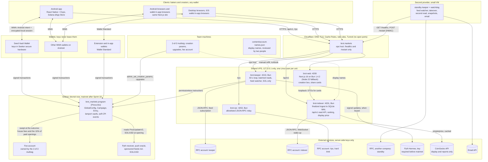

# Brot Markets — System Architecture Proposal

**Version:** 0.4 · **Status:** approved by the founder on 2026-10-08 ("sim para todos") · **Date:** 2026-10-08 · **Business base:** BP v0.0.4 (draft) of
2026-10-08 · **Technical base:** `docs/technical/TECHNICAL-PLAN.md` v0.0.1, approved on 2026-10-05 · **Covers:** the
program that open campaign creation needs, in SOL and on Pinocchio; backend services; indexing; data stores; the
Android app; and a phased execution plan with exit criteria.

This document is in English because the first request asked for it. Approved on 2026-10-08, it is the base of the
Technical Plan rewrite; until that rewrite lands, the Technical Plan v0.0.1 text is outdated where the two differ. Changes are marked **[NEW]**, decisions are collected in section 5, and section
6 lists what changes elsewhere now that it is approved. P4 §3.3 asks for Sprint 02 and the Technical Plan to be revised
before Sprint 02 starts, with this proposal as the base, and the BP index adds the Product Brief and the design
direction; this is the technical input for that review.

**Where the business base lives.** BP v0.0.4 is in `docs/business/`: the index `BUSINESS-PLAN.md` and four parts,
which keep v0.0.3's section numbers, so "P1 §3.4" is Part 1, section 3.4. Every BP citation here was checked against
those files on 2026-10-08.

**Founder decisions of 2026-10-08.** The founder's answers to BP v0.0.3's open questions, D-a to D-t, are recorded
in BP v0.0.4 and `session-log/2026-10-08-decisoes-do-fundador-bp-v0.0.4.md`; cited as "(D-h)", labelled **[FD]**.
Proposals still open are P-6 to P-9 (with a hyphen; "P1" is Part 1 of the BP), plus two new open items
the BP index lists as "Nova" (§5.1). D-f is the founder's request for research ("coingecko ou outro, pesquise"); the
BP's answer to it, Pyth on-chain and CoinGecko for display, was confirmed on 2026-10-08 (P1 §4.1, §5.2).

**What changed from 0.3** (written the same morning against BP v0.0.3):
1. Vocabulary: the product unit is an **On-Chain Campaign**; bakers join it, a creator opens it (D-m). D6 renames the
   code.
2. Money is SOL only (D-a): lamport vaults, payouts straight to wallets. USDC, its mint and its freeze risk are gone.
3. Opening costs US$500 in SOL at the Pyth SOL/USD price: 90% a neutral prize, 10% to Brot (D-b, D-f). The 0.02 SOL
   fee and its rent deduction are removed.
4. The creator's 1% comes from the pot, and from Brot's fee only when winners would get back less (D-g) (§2.4.4).
5. No caps and no accepted-account list (D-h, D-i): `CapState`, `AcceptedAccount`, `MarketKey`, the cost-to-force
   cap and the squatting section are removed. Mainnet needs an audit and a multisig.
6. Pinocchio replaces Anchor (D-o); Quasar is rejected.
7. No AI (D-q): the AI section, the assistant, the MCP server and their sources are removed.
8. Every service runs on Bun 1.4.2; the site too, if it passes a staging test (D-p).
9. The Seeker-channel section becomes **the Android app** on the Solana dApp Store, with its own phase (D-n).
10. No deadline (D-r): the demo slice for 2026-10-12 is removed. The lawyer is on the team (D-s). The sponsor request
    is removed (D-t).

**Vocabulary.** Brot Markets runs **On-Chain Campaigns** ("campaigns" from here on). A campaign asks one YES/NO
question that an on-chain account answers. A **baker** is a wallet that joins it; the amount a baker puts in is an
**entry**; the **creator** opened it; the winning side splits the **pot**. Portuguese copy: "campanha", "criador",
"baker", "SIM/NÃO", "pote", "entrada", "entrar no SIM / no NÃO" (D-m). The brand Brot Markets and the domain stay. A
cited law, store policy or third-party document keeps its own term, quoted. Our words do not change how a regulator
classifies the activity **[INF]**; that goes to the team's lawyer (§3.10). Identifiers are renamed once, in D6.

**Labels.**
- **[F]** fact read in a repository file, with its path, or measured on the chain, with the call.
- **[FD]** founder decision of 2026-10-08 (D-a to D-t); not reopened.
- **[BP]** earlier BP rule marked "Decisão" and kept in v0.0.4; not reopened.
- **[BPP]** BP v0.0.4 "Proposta, aguardando decisão" (P-1 to P-9 and the two new items), and its proposal for D-f's
  price source: the architecture builds the recommendation and keeps it switchable.
- **[DP]** decision of the approved Technical Plan, kept. **[NEW]** proposal of this document.
- **[E#]** external fact, Appendix C. **[INF]** inference. **[Q]** needs a founder decision. **[AC]** to verify.

**Short names.**
- BP = BP v0.0.4; P1–P4 = its parts. "BP-14" = decision 14 of v0.0.3's list of nineteen; those still open are
  carried in P-9. "v0.0.2 P1:772" = a line of an older part file. "v0.0.3 P4 §2.2" = a section of v0.0.3
  (`docs/business/_review/BP-v0.0.3-completo.md`) whose rule v0.0.4 keeps by leaving it unchanged.
- TP = Technical Plan. PB = `docs/product/PRODUCT-BRIEF.md`. OCR = the open-creation research of 2026-10-07,
  `knowledge-base/market/pumpfun-model-for-open-markets.md`. R-xx, F-x, L-xx = the Product Brief's rules, flows and
  gaps. BR-xx = Appendix A.
- "The program" = `programs/brot-markets`. SOL amounts use US$109.27 per SOL (CoinGecko, 2026-10-08, 15:29 UTC,
  D-e) [E80].
- "Phase 0–3" are stages of this proposal, not the wizard's phases; their exit criteria are X0–X3, not the roadmap's
  six gates.

## 0. Summary

1. **The program changes framework; the services do not.** One Pinocchio program holds every rule that moves money
   (D-o); a stateless keeper pair runs the open instructions; a rebuildable SQLite indexer serves a read-only API; the
   site and the Android app sign through the baker's wallet. Every off-chain process runs on Bun 1.4.2 (D-p). The
   numbers are small (150 to 1,500 active wallets at month 3, P2 §5.6), so PostgreSQL, Redis and a gRPC indexer stay
   rejected, each with its trigger (§2.12).
2. **Money is SOL, end to end (D-a).** Each vault is a data-less program-owned PDA holding lamports; balances are
   bookkept; a payout is a direct credit to the wallet, with no token account, mint or freeze authority. One new edge
   case: a credit below the rent-exempt minimum to an empty wallet fails, which a 0.01 SOL minimum entry (P-5) keeps
   away from entries (§2.4.6).
3. **"Inside the rules" is program code** (P4 §3.3: "regra fora da abertura não existe").
   `user_open_campaign` replaces TP §3.4.3's two-person flow and checks the kind, the account, the duration, the fees
   and the payment (§2.4.3). No free text (D-j), no list (D-i), no cap (D-h).
4. **Opening costs US$500 in SOL, priced on-chain (D-b, D-f).** The program reads Pyth SOL/USD and puts the payment
   in the vault: 90% as a neutral prize, 10% held for Brot until the outcome (T23). A program cannot read CoinGecko,
   which serves display only (§2.4.5). Team keys and launch partners open free, with no creator share (D-c, D-d, P-3).
5. **The creator's 1% is one pure function (§2.4.4):** from the pot while winners stay whole, the shortfall from Brot's
   fee (D-g, read as P-2 proposes). "Winners never get back less than their entry" is a tested invariant.
6. **No caps and no list have a price (§2.4.7).** A program bug has no ceiling. A creator who can move the measured
   account, for example by burning a worthless token, profits once a little over US$56 of third-party money sits on
   the other side. Mainnet needs both audit reports and a 2-of-3 multisig (K-12); the slide that says "and a cap"
   must change.
7. **Third-party campaigns scale the services, not their kind:** batched reads, price per feed, a `max_open_campaigns`
   valve, review by exception, and ranking that unlists empty campaigns off-chain (§2.7).
8. **Three growth surfaces:** a share card, a re-check panel and a creation box on a template grammar (§2.9). The
   prototype has no creation screen and no layout below 700 px (D8).
9. **No AI (D-q).** Sprint 09 still removes the chat route inherited in `app/`.
10. **The Android app (D-n)** reuses `/api/v1`, `/rpc` and the SDK, with a React Native front and Mobile Wallet Adapter,
    on the Solana dApp Store; iPhone stays on the website in wallet browsers. It is Phase 3 (§3, §4).
11. **Decisions.** §5.1 maps D-a to D-t, P-1 to P-9 and the BP's two new open items onto sprints: P-1 to P-5 and D-f
    were decided on 2026-10-08. This proposal keeps L0 and D3 to D8 (§5.2).

## 1. System Architecture Overview

### 1.1 What was read, and what this does not reopen

**Read in full for 0.4:** the founder's decisions of 2026-10-08 with that day's numbers and research (Bun,
Pinocchio, the CoinGecko price), BP v0.0.4 (the index and its four parts), and version 0.3. **Read for 0.3:** BP
v0.0.3, TP §3.4, `docs/SPRINTS.md` and OCR. **Read for 0.2:** the Product Brief, the design direction, the sprint files, the `knowledge-base/` notes and the code.
External facts are listed in Appendix C; package versions were not re-checked after 2026-10-07, except Pinocchio and
Bun.

**Not reopened:** every **[FD]** and **[BP]** rule; the TP §3.4 program design, except where §2.4 changes it; the
sprint order, except the slots §4 proposes; the shared-server house rules.

### 1.2 Constraints that shape every choice

| # | Constraint | Source |
|---|---|---|
| K-01 | Money moves only through the program. Services hold no on-chain privilege, and no instruction lets anyone move a baker's entry anywhere the rules do not send it | TP §3.4.9 **[DP]**; P4 §4.2 |
| K-02 | Outcomes come from typed reads of on-chain accounts. No opinion oracle, no vote, no model. The pitch says "Sem votação, sem chave da empresa, sem IA" | P1 §2.1, §4.5 **[BP]**; D-q |
| K-03 | A baker or creator is a wallet signature: no signup, session or cookie | P1 §2.2 **[BP]**; TP §5 |
| K-04 | Joining or opening a campaign collects no personal data, and the KPIs are computed without personal data. The BP says "quase tudo" of its KPIs comes from the program's public record (P2 §6.3) | TP §8 **[DP]**; P2 §6.3 |
| K-05 | The off-chain database is a disposable copy of the chain, and no on-chain money decision reads it. One exception: the weekly referral payout of Sprint 14 is computed from it (TP §3.4.11). From then on, payouts read finalized rows only and the file is snapshotted | TP §3.5 **[DP]**; exception **[NEW]** |
| K-06 | Shared VPS: Hostinger KVM 2, 2 vCPU x86_64, 7.9 GB RAM, Ubuntu 22.04. User `brot` with no Docker, sudo or SSH; ports on 127.0.0.1:4200–4299 only; ingress only through Brot's own Cloudflare Tunnel | TP §12; `knowledge-base/tecnologia/servidor-e-dominio.md` **[F]** |
| K-07 | The program is built only in GitHub CI (`cargo build-sbf`), and the deployed artifact's SHA-256 is checked | TP §10, §12; roadmap gate 4 **[DP]** |
| K-08 | Infrastructure at most US$1,000 a month inside a US$5,500 monthly cost. Three partners; the CTO receives the alerts and has no backup person | P2 §1.3; P4 §5.1, §5.2 **[BP]** |
| K-09 | Active wallets at month 3: 150, 375 or 1,500. Break-even near US$208,630 of monthly volume with no paid opening; each sends US$50 to operations, so N a month lower it to `(5,500 − 50 × N) ÷ 0.0263625`: about US$170,700 at N = 20, zero at N = 110 | P2 §1.4, §5.2, §5.6 (projections **[INF]**; the N formula is P2 §5.2's) |
| K-10 | No third-party script on campaign pages; Cloak and SODAX on their own pages | v0.0.3 P4 §2.2 **[BP]**; PB:345 |
| K-11 | A country switch that hides only the entry panel and never blocks payouts | P4 §5.2 **[BP]**; TP §3.6 |
| K-12 | Mainnet only after the external audit, with both firms' reports on the exact version, and a 2-of-3 hardware multisig. The 5/10/2026 exception (open after one report, with a lower cap) lost its cap; the BP proposes waiting for both reports (new open item, §5.1). The slide still says "MAINNET After an audit, a multisig and a cap"; the cap was removed (D-h), so the slide must change (the BP proposes "After an audit and a multisig", P4 §3.1). If either is missing, the date moves | P4 §3.1, §3.4, §4.1 **[BP]**; D-h **[FD]** |
| K-13 | No external date drives the plan (D-r). The program still has no instruction | **[FD]**; `programs/brot-markets` **[F]** |
| K-14 | Brazil, MP 1.394 of 2026-09-25, prohibits "apostas de quota fixa", offshore operators that reach Brazil included. Art. 21 obliges app-store and OS providers to prevent prohibited products from being made available; art. 22, II fines them up to 10% of the group's Brazilian revenue, at most R$50M per infraction. Its deadline in Congress is 2026-11-23, extendable once by 60 days; progress there is unchecked (OCR, "Repo numbers now outdated") | P4 §6.1; `knowledge-base/market/regulacao.md:15, 46-65` **[F]**; date [E28] |
| K-15 | Any wallet opens a campaign, only of a kind the chain can answer, by paying US$500 in SOL; 90% becomes a neutral prize. The team and the launch partners open without paying and take no creator share; any other creator receives 1% of the entries | P1 §4.1 **[BP]**; D-b, D-c, D-d, D-g, P-3 **[FD]** |
| K-16 | One currency, SOL, for entries, pot, prize, payouts, refunds, referral and fees | D-a **[FD]** |
| K-17 | No free text in a campaign: the site builds the sentence from the kind, the account, the target and the date | D-j **[FD]** |
| K-18 | No cap, global or per campaign, and no list of accepted accounts: any account the kind's reader accepts can be used | D-h, D-i **[FD]** |
| K-19 | The program is written with Pinocchio, without Anchor | D-o **[FD]** |
| K-20 | Mobile is an Android app on the Solana dApp Store; iPhone uses the website | D-n **[FD]** |

### 1.3 Load: averages, peaks and abuse

| Situation | What happens | Size **[INF]** | What it stresses |
|---|---|---|---|
| Average day, optimistic month 12 | Entries spread across the day | 1,000–2,500 a day (US$1.5M a month at US$20–50 each); under one transaction a second | Nothing |
| Entry close of a popular campaign | Late entries in the last hour | Tens to a few hundred in an hour | The campaign account and its vault. With no global cap account (D-h), campaigns share no writable account; the per-account write limit (TP C7) is measured in Sprint 04 |
| A price touch | One resolve, then people checking | One transaction; a burst of page and RPC reads | `/rpc`, which an edge cache cannot absorb |
| Payout of a large campaign | `settle_entry` for every entry | Entries ÷ batch size (T3) transactions | Keeper fees and RPC calls |
| A card that spreads on X | Page and card views | Thousands of views in an hour | The edge cache (a Cloudflare Cache Rule, §2.8), card rendering (§2.9) and `/rpc` |
| **Opening burst [NEW]** | Many campaigns opened at once | A wallet pays US$500 (about 4.58 SOL) each; a team key opens free, so a leaked one is the cheap path | Keeper reads, indexer, home page: hence `max_open_campaigns`, ranking (§2.7) and revoking team keys |
| Abuse | Scripts against `/rpc` | Unbounded | The paid RPC quota, hence §2.6's separate accounts and limits |

**RPC volume [INF].** At optimistic month-12 volume, the indexer, keeper and watchdog make on the order of a few
hundred thousand RPC calls a month. Open creation adds one account read per open campaign per keeper cycle, batched
100 to a `getMultipleAccounts` call: 1,000 open campaigns are 10 calls a minute, about 432,000 a month. `/rpc` grows
with visitors: about eight calls per entry, plus reads per page view. Per-method credit weights were not verified
**[AC]**. Sprint 08 measures them, and each service gets its own provider account so that `/rpc` can never starve the
keeper.

### 1.4 Topology



### 1.5 Trust boundaries and architecture invariants

| Zone | What lives there | What it may do | What it may never do |
|---|---|---|---|
| Z0 On-chain | The program and its accounts | Move SOL as the rules say, recompute every value, enforce roles and states | Trust any off-chain input it can recompute |
| Z1 Wallet | The baker's or creator's keys (Seed Vault through Seed Vault Wallet on Seeker; an extension or an in-app wallet elsewhere) | Sign what its owner approves | — |
| Z1b Creator | Any wallet that opened a campaign | Open campaigns within the rules, on any account a reader accepts (D-i); join its own campaigns (BP-14); receive the 1% | Choose the fee, the share, the opening price, or any text |
| Z2 Service wallets | Keeper wallets 1 and 2, SOL for network fees only | Call permissionless instructions | Choose an outcome, an amount or a destination (TP §3.4.5–3.4.6); reach the fee account |
| Z3 Team and admin | Team keys, one per person; the admin and upgrade authority, a 2-of-3 hardware multisig on mainnet | Team keys: confirm, void, contest, pause, open free, with no creator share, for the team or a launch partner (D-c, D-d, P-3). Multisig: creation parameters, resume, team keys, upgrades, the fee account | Invert a result; move a baker's entry; change an open campaign's fee or share |
| Z4 Read path | Indexer, API, `/rpc` relay, site, Android app | Copy, aggregate, rank, relay allowlisted traffic, display | Hold a signing key; decide anything about money |
| Z5 Third parties | RPC providers, Pyth, CoinGecko, email, Cloudflare, the dApp Store | Provide data, transport and distribution | Be trusted for correctness: the program checks Pyth's verification, the keeper simulates, the standby re-reads elsewhere, and CoinGecko never reaches the program |

Invariants that tests, rules or the deployment enforce **[NEW]**:

- **A-1 No key moves bakers' money.** No off-chain process holds a key that can move SOL out of a vault, and no such
  key exists (TP §3.4.9).
- A-2, the rule that kept AI code away from signing, was removed with D-q. The SDK split it relied on stays for its
  own sake (§2.3).
- **A-3 A deterministic summary before every signature.** Every transaction a baker or creator signs is built by
  `@brot/sdk/tx` from validated inputs, re-reads the accounts it depends on, is simulated, and is summarised by
  deterministic code.
- **A-4 The chain can rebuild everything else.** Every off-chain table can be rebuilt from the chain and `content/`,
  except two evidence tables: the price-feed history (§2.5) and the referral payout ledger (K-05). Those are
  snapshotted nightly to VM 2.
- **A-5 No client holds a paid key.** No browser, PWA or Android app receives a paid RPC key, the Pyth key or the
  CoinGecko key. Only `brot-rpc` reaches a provider for clients, and only for allowlisted content (§2.6).
- **A-6 One SDK.** The site and the Android app import the same `@brot/sdk` for PDAs, money math, creation checks,
  public state and event decoding. Only the screens differ, and neither has a signing path outside the wallet.
- **A-7 Chain time decides public state.** Public state ("Aberto", "Fechado" and the rest) is computed by one SDK
  function against chain time, never the device clock. The API returns `chain_time` with every response.
- **A-8 Signing pauses during an upgrade.** The client compares the program's on-chain last-deploy slot (ProgramData)
  with the one its bundle was built for. On a mismatch it stops signing, then backs off and reloads. Signing never
  depends on the indexer being reachable.
- **A-9 A retry never adds a second entry or a second opening.** The join instruction takes `expected_entry_total` and
  fails if the baker's entry changed since the client read it; an opening reuses its client-chosen `id`, so a repeat
  fails on the existing account (§2.4.3).
- **A-10 No creation rule lives only in the site.** Every rule of §2.4.3 is checked in `user_open_campaign`. The site,
  the app and the SDK mirror the checks for the preview, and a test feeds each refused case straight to the program.
- **A-11 No creator-supplied text is stored or shown.** Creation takes enums, numbers and addresses only. Names come
  from `content/account-names.json` or the pinned Pyth feed list, never from token metadata that the token's owner can
  change. An account with no reviewed name shows its shortened address and an explorer link.

### 1.6 Communication protocols

| Link | Protocol | Notes |
|---|---|---|
| Client ↔ site | HTTPS through Cloudflare; server-rendered HTML + JSON | Security headers and CSP in `next.config.ts`, missing today (Sprint 09 DoD) |
| Client (site or app) ↔ read API | REST/JSON, `GET /api/v1/*` | Read-only (TP §6). `Cache-Control` with `s-maxage` of 2–10 s, which caches only with a Cloudflare Cache Rule **[AC]**. Unknown query parameters return 400 |
| Client (site or app) ↔ chain | JSON-RPC 2.0 over HTTPS through `brot-rpc` | Content allowlist, no batches, 8 KB bodies, a weighted rate budget (§2.6). Signature status is polled (`getSignatureStatuses`, `getBlockHeight`); there is no WebSocket for clients |
| dApp ↔ wallet, Android | Mobile Wallet Adapter 2.x [E1]: an Android intent with a `solana-wallet:` URI, then a local WebSocket session (ECDH P-256, AES-128-GCM) | Client-only (§3.5). Chrome shows Local Network Access dialogs on first connection [E5]; the native app is outside Chrome **[INF]** |
| dApp ↔ wallet, elsewhere | Wallet Standard, in-page JavaScript | Through `@solana/wallet-adapter-react` (TP §1, §3.6) |
| Keeper, indexer, watchdog ↔ RPC | JSON-RPC over HTTPS. WebSocket `logsSubscribe` and `accountSubscribe` serve only as wake-up hints | A gRPC stream stays behind the same interface until a trigger (§2.12) |
| Keeper ↔ Hermes | HTTPS + Server-Sent Events, with an `Authorization: Bearer` key [E51] | Needed for proofs before mainnet (§2.5) |
| Indexer → CoinGecko **[NEW]** | HTTPS, `simple/price` for SOL in USD, every few minutes, server-side | Display and reports only; never an input to the program (D-f) [E79] |
| Watchdog ↔ keeper | HTTPS through the ops host: `GET /healthz`, and `POST /restart` with HMAC-SHA256 over timestamp and body | TP §3.5 |
| Service ↔ service | Loopback HTTP/JSON | No gRPC, no message bus |
| Site or app → X | A plain share-intent link opened by the visitor **[NEW]** | No X script or widget on any page (K-10); no X API |
| Services → email | HTTPS API of an email provider | Provider still open (TP T5) |

### 1.7 Service catalogue

| Service | Runtime | Listens on | State | Secrets (through `LoadCredential=`, §2.10) | Built in |
|---|---|---|---|---|---|
| `brot-web` | Next.js 16.3.8 on Bun 1.4.2 if the staging test passes; Node 22 otherwise (D-p) | 127.0.0.1:4200 | None | None | Sprint 09 |
| `brot-indexer` | Bun 1.4.2 | 127.0.0.1:4201 | SQLite: rebuildable tables plus two evidence tables | RPC key (indexer account); CoinGecko key, if a paid plan | Sprint 08 |
| `brot-rpc` **[NEW]** | Bun 1.4.2 | 127.0.0.1:4202 | Short-TTL cache in memory | RPC key (`/rpc` account) | Sprint 08 |
| `brot-keeper` primary | Bun 1.4.2 | 127.0.0.1:4210 | None: re-reads the chain each cycle | Keeper wallet 1 (SOL only), RPC key (keeper account), HMAC secret, Hermes key when bought | Sprint 06 |
| standby keeper + watchdog | Bun 1.4.2, on VM 2 | Outbound only | Snapshots received | Keeper wallet 2, RPC key B (another company), email key, HMAC secret | Sprint 07 |
| `services/landing` | Node, no dependencies | 127.0.0.1:4200 | `leads.jsonl` | — | Exists; leaves at Sprint 09 |
| Android app (`mobile/`) | React Native with Expo, on the phone | — | The wallet's authorization cache and a pending-entry snapshot | None | Phase 3 |

**The keeper's tasks** (TP §3.5 and §3.4.3, with §2.5 and §2.7). Each cycle it reads every open campaign's metric
account in batches of 100 and resolves what it can; finalizes after `review_ends_at`; settles entries in simulated
batches, then the creator share; retries reserved payouts daily (in SOL, only credits that would leave an empty wallet
below the rent minimum, §2.4.6); then runs `collect_fee`, `settle_prize`, `close_campaign` and `sweep_fees`. Each is
idempotent (TP §3.4.3). The keeper holds and spends only SOL (D-a).

## 2. Tech Stack & Dependency Matrix

### 2.1 Program framework and off-chain runtime

#### Program: Pinocchio 0.11.x [FD] (D-o)

**Facts.**
- Pinocchio is Anza's library for Solana programs. It has no external dependencies, reads accounts in place and
  generates no code. Version 0.11.2 was published on crates.io on 2026-06-09 [E72].
- Zellic audited it, and Anza built p-token on it; p-token replaced SPL Token on mainnet in 2026 [E73].

**What Anchor did that the program now does by hand.** Everything in this table lives in one `checks` module or in
the instruction that needs it, and each row has a negative test (T24).

| Anchor gave | In the program | Negative test |
|---|---|---|
| Owner check on typed accounts | `checks::owned_by` for every account the program treats as its own; each reader checks its kind's owner | The same bytes under another owner |
| `Signer`, `mut` | `checks::signer`, `checks::writable` per account slot | An unsigned or read-only slot |
| 8-byte discriminator | A tag per account type, written at creation and checked on every load | A wrong tag; a zeroed account |
| `seeds` and `bump` | Re-derive with the stored bump and compare the address | A look-alike address |
| Typed deserialization | Exact length per account type before any read; fixed little-endian layouts read by offset | Short and long buffers |
| `init` | A System Program `create_account` signed with the PDA's seeds. If the address was funded in advance by anyone, top it up, `allocate` and `assign` instead | A vault address funded before opening |
| `close` | Move all lamports out, zero the data and reassign the account to the System Program | Revival in the same transaction |
| `has_one` and constraints | Explicit comparisons with stored keys | An `Entry` of another campaign |
| `emit_cpi!` | A hand-written self-CPI, or `sol_log_data` (T4, §2.3) | The decoder tests of §2.3 |
| The IDL | Shank attributes on accounts and instructions; Codama renders the TypeScript client (T9) | The CI IDL check |
| Error codes | One enum mapped to custom program errors | Each refusal has its own code (X0.7) |

**Costs and gains [INF].**
- More code for the team to write and the auditor to read: the checks module is the newest risk, hence a test per
  check that fails when the check is removed (T24, X0.9).
- No framework version coupling: the frozen program's pins leave with it (the `solana-epoch-stake` pin per §5.4).
- Lower compute and smaller binaries are the usual claims; nothing here depends on them.
- The lamport vault of §2.4.6 is natural: the program moves lamports between accounts it owns, without a CPI.

**Quasar was rejected:** beta, unaudited, no published version; its README says it "has not been audited. APIs may
change." [E74][E75].

**House rules carry over:** one instruction and one reader per file, under 200 lines, a `Purpose:` header, checked
math. The rule against `init-if-needed` becomes: never re-initialise an account that already carries a tag.

**Build and CI [NEW].** `bun run build:program` runs `cargo build-sbf`, then the Shank IDL and the Codama client, and
syncs both into `packages/sdk`; the stale-IDL check compares them with CI's build. `pred-provable` leaves the workspace
once its readers are ported, at the latest in Sprint 03, taking `anchor build`, the Anchor CLI install and its clippy
line with it. `CLAUDE.md` changes are listed in §6.

#### Off-chain runtime: Bun 1.4.2 [FD] (D-p)

**Choice.** All off-chain code is TypeScript. Every service runs on Bun 1.4.2, the exact version, with the binary's
checksum verified at deploy. The site runs Next.js 16.3.8 under Bun 1.4.2 if it passes a staging test (build,
`next start`, the E2E smoke); Node 22 is the fallback for the site only. Services use `Bun.serve` with no web framework,
and zod 4 is the one schema library **[NEW]**.

**Why.** With one language, the keeper, indexer, relay, site, Android app and tests import the same SDK, so PDAs,
money math, creation checks, event decoding and public state exist once: desync is prevented by a single
implementation, not by a protocol. Bun ships SQLite and runs TypeScript without a build step. Rejected: Rust services
(a second copy of the math), Python (a third language), NestJS or Express (weight for a few read-only routes, TP §6),
gRPC between a handful of local processes.

**What was checked for D-p on 2026-10-08.**

| Question | Finding | Label |
|---|---|---|
| Maturity | Bun 1.4.0 shipped on 2026-08-19 or 20 as the first release of its Rust port; 1.4.2 is the current stable. Bun counts 19 known regressions of the port, all fixed, and 1,500 more Node.js tests passing. It still says it "is not 100% compatible with Node.js yet" | [E52], partly secondary |
| Requirements | glibc 2.17 or newer; kernel 5.6 or newer recommended; an x64 CPU with SSE4.2 | [E76] |
| Our VPS | Ubuntu 22.04 ships glibc 2.35 and kernel 5.15. The CPU flags of the Hostinger VM are unknown | **[INF]**; the first step of Sprint 06 checks all three (TP C8) |
| Security | One CVE in 2026, CVE-2026-24910 (medium), fixed in 1.3.5. Bun runs no dependency install scripts outside a trusted list, which narrows supply-chain risk | [E77], secondary |
| Next.js under Bun | Bun's guide says it runs a production Next.js server; the Next.js documentation found does not confirm it; a community report describes a Next 16.3 build failing with Bun on Vercel | [E78], secondary |
| Use elsewhere | Prisma reports running the Rust Bun in production | [E52], secondary |

**Rules [NEW].** Keep the install-script block: no `trustedDependencies` entry without review. Soak-test the services
in Sprint 06. Keep SQLite access behind a small adapter, so a failed VPS check reopens D-p without rewriting services.

### 2.2 Dependency matrix

Versions of the program, Bun and Pinocchio rows were read on 2026-10-08; the others on 2026-10-06 and 07.

| Layer | Package or tool | Version to pin | Status | Source |
|---|---|---|---|---|
| Program | `pinocchio`; `pinocchio-system` for System Program CPIs | 0.11.x (0.11.2); the matching `pinocchio-system` **[AC]** | **[FD]** D-o | [E72] |
| Program | `checks`: owner, signer, writable, tag, PDA, length; creation and closing | Sprint 02 | **[NEW]** T24 | §2.1 |
| Program | Rust; Solana CLI with `cargo build-sbf` | 1.89.0; 3.1.10; Pinocchio 0.11 checked with them on day one **[AC]** | **[F]** | `rust-toolchain.toml`; `ci.yml:18` |
| Program | Lints that deny unchecked arithmetic and truncating casts; `overflow-checks` in release | — | **[F]** | `programs/brot-markets/Cargo.toml:38-41`; root `Cargo.toml:11-12` |
| Program | Events: hand-written self-CPI, or `sol_log_data` | — | **[NEW]** T4 | [E48] |
| IDL | Shank attributes and its CLI | Pinned after the spike **[AC]** | **[NEW]** T9 spike | §2.1; [E81] |
| SDK codegen | `codama`; `@codama/nodes-from-anchor` (reads Shank's IDL format **[AC]**); `@codama/renderers-js` | 1.11.0; 1.5.6; 2.5.0 (needs Kit ≥ 8.3, renders events) | **[NEW]** T9 spike | [E50][E81] |
| Price data | Hand-written `PriceUpdateV2` reader, upgraded receiver only, no Pyth crate; also SOL/USD at opening | — | **[F]**; SOL/USD **[NEW]** | `readers/price_touch.rs` |
| Rust tests | `litesvm` crate; `mollusk-svm` for the checks module | 0.17.0 (`set_epoch_stake` since 0.15.0) **[AC]**; 0.16.0 | **[AC]** | [E49] |
| Integration | Surfpool | 1.6.0, with a SHA-256 check | **[DP]** Sprint 03 | [E49] |
| TS tests | `@solana/kit`; `litesvm` (npm); `@solana/kit-plugin-litesvm` | 8.4.0, once a frozen install and typecheck pass; 1.5.0; 0.19.0 | **[F]**; bump **[NEW]** | `package.json:36-39`; [E50] |
| Schemas | `zod` | 4.x, pinned in Sprint 05 | **[NEW]** | — |
| SDK boundary | `dependency-cruiser` for the read/tx split (§2.3) | Pinned in Sprint 05 | **[NEW]** | — |
| Site | `next`; `react`; `@solana/web3.js` | 16.3.8; 19.2.8; 1.99.0 (1.x gets critical fixes only; 3.x is Kit-based [E50]) | **[F]**; the frozen program's client leaves (T9) | `app/package.json` |
| Share card | `next/og` (`ImageResponse`); self-hosted fonts | With `next` | **[NEW]**; convention checked in `app/node_modules/next/dist/docs/` **[AC]** | `app/AGENTS.md` |
| Wallets, web | `@solana/wallet-adapter-react`; `@solana-mobile/wallet-standard-mobile` | 0.15.40; 0.6.0, explicit with `registerMwa` | **[F]**; explicit **[NEW]** | `app/package.json`; `bun.lock:379, 271, 273`; [E2][E7] |
| Runtime | Bun; Node for the site if staging fails | 1.4.2 exact, checksum verified; 22 LTS | **[FD]** D-p | [E52][E76][E77] |
| Store | SQLite through `bun:sqlite`, WAL mode | — | **[DP]**; WAL **[NEW]** | TP §2 |
| Display price | CoinGecko `simple/price`, server-side | Plan per D4 | **[FD]** D-e; D-f **[FD]** | [E79][E80] |
| Android app | Expo (custom development build); React Native; `@wallet-ui/react-native-kit` or the MWA protocol packages; `dapp-store-cli`; `solana-mobile` CLI | Expo pinned in Phase 3; 4.3.0 or 2.3.0 / 0.4.0; 1.0.1; 0.5.0, in `mobile/package.json` | **[FD]** D-n | [E2][E6][E23] |
| Sign-in, optional | `@solana/wallet-standard-util` | 1.2.0 | **[NEW]** only with H1 | [E13] |
| Web E2E | Playwright | Pinned in Sprint 11 | **[NEW]** | — |
| Ops | `cloudflared` | 2026.9.3 | **[F]** | `knowledge-base/tecnologia/servidor-e-dominio.md` |
| Registry | npm registry for `bun.lock` | npmjs.org instead of npmmirror.com, before any new dependency | **[NEW]** (TP §7.1: Sprint 16) | TP §7.1 |
| Removed in 0.4 | `anchor-lang`, `anchor-spl` and their `event-cpi` feature; `@anchor-lang/core`; SPL Token CPIs for the pot; `USDC_MINT`; every AI package of 0.3 | — | **[FD]** D-o, D-a, D-q | — |
| Not used | Quasar; gill (needs Kit ^5); Seeker Connect 0.1.x; Redis/Valkey; PostgreSQL | — | §2.12 | [E74][E75][E50][E14] |

**Why Codama is a spike.** Pinocchio generates no IDL. Shank attributes describe accounts and instructions, and
Codama renders a Kit client from that IDL (builders, codecs, an error map). A QuickNode guide builds a Pinocchio
program's IDL with Shank and its client with Codama, and the Solana docs describe Codama clients [E81]: the path is
documented, but it has not been tried here with the pinned versions. A half-day spike in Sprint 02
renders one account and one instruction and round-trips them in LiteSVM; if it fails, the SDK writes its codecs by
hand, with a byte-for-byte test against the Rust serializer (T9).

### 2.3 Data contracts: the layer that prevents desync [NEW]

| Contract | Single source | Consumers | Drift check |
|---|---|---|---|
| Program interface | The Shank IDL from the CI build | `packages/sdk/src/idl`, the generated client | CI IDL check **[F]** (`ci.yml:112-120`), moved to the Shank output |
| Account checks | `checks.rs` | Every instruction | One negative test per check, shown to fail without it (T24) |
| Events | `events.rs`, emitted by self-CPI (T4) | SDK `events` decoder (rules below) | Tests: a forged event is ignored; a failed transaction is ignored; an event inside a lookup-table transaction decodes |
| Money math | `math/fees.rs`, `math/payout.rs` (with the creator share), `math/opening.rs` (US$ to lamports), `math/schedule.rs` | SDK `math` mirror | At least 10,000 vectors generated by the Rust pure functions and replayed against the TypeScript mirror |
| Creation rules | `instructions/campaigns/open_campaign.rs` and `math/schedule.rs` | SDK `validateOpenCampaign` (preview only; the program decides, A-10) | One test per refused case, fed to both; the SDK must refuse at least what the program refuses |
| Public state | SDK `view`, against chain time | Site, Android app, API | A unit test per state |
| Read API | `@brot/sdk/read` schemas (zod), written in Sprint 08 | Indexer, site, Android app | Contract tests; `/api/v1/health` returns `program_last_deploy_slot`, `schema_version`, `cluster` and `entries_allowed` |
| Hand-written content | `content/*.json`: partners, void log, account display names **[DP + NEW]** | Site, indexer, team scripts | JSON Schema check in CI |

**The SDK split.** `@brot/sdk/read` (PDAs, codecs, math, public state, decoders, API schemas) and `@brot/sdk/tx`
(transaction builders, simulation, the deterministic summary). The indexer and the relay import only `read`, and a
`dependency-cruiser` rule enforces it, so the read path cannot build a transaction it was never meant to send.

**Decoder rules** (the 0.2 review's findings; they hold for every consumer):
1. Skip any transaction whose `meta.err` is not null. `app/lib/history.ts:28,37` already does this.
2. With self-CPI events, accept an event only from an inner instruction of the brot program signed by its
   event-authority PDA. With `sol_log_data`, accept only `Program data:` lines inside the brot program's own
   invocation frame. Either replaces today's decoding of every `Program data:` line (`app/lib/market.ts:202-209`),
   which is a decoder bug in its own right.
3. Resolve inner-instruction account indexes through `loadedAddresses`, so that settle batches using lookup tables
   decode correctly.
4. Key each event by `(signature, top-level instruction index, inner instruction index)`. One top-level instruction,
   such as a multisig execute, can hold two of our CPIs.

**Conventions.**
- Amounts are lamport strings, addresses are base58, and times are Unix seconds in UTC (TP §6). A US$ value is
  display-only and carries its source and time.
- Every list response carries `as_of_slot` and `chain_time`.
- `/api/v1` changes only by adding fields.

### 2.4 Open creation in the program [rewritten in 0.4]

The BP moves a campaign from "two team members open it" to "any wallet opens it, inside the rules" (P1 §4.1,
**[BP]**), and the founder made the opening a US$500 payment in SOL (D-b). The checks the team applied by hand become
program checks (P4 §4.3). This section is the program delta against TP §3.4, written with the D6 names. Where a BP
proposal waits for the founder, the design builds its recommendation and says what changes if the answer differs.

#### 2.4.1 Accounts

| Account | Seeds | Change against TP §3.4.1 |
|---|---|---|
| `GlobalConfig` | `["config"]` | Adds `opening_fee_usd` (500), `opening_prize_bps` (9,000), `creator_share_bps` (100), `fee_recipient`, `max_open_campaigns` with its `open_campaigns` counter, `min_entry_lamports` (10,000,000 under P-5), and the SOL/USD `feed_id`, `max_price_age` and `max_price_conf_bps`. `loser_fee_bps` becomes `fee_bps` (T11). Code ceilings: `MAX_FEE_BPS` (1,000), `MAX_CREATOR_SHARE_BPS` (100) |
| `Campaign` | `["campaign", id]` | Drops `proposer`, `approver`, `text_hash`. Adds `creator`, `creator_share_bps` (100, or 0 whenever a team key opens, P-3), `template_version`, `opening_paid_lamports`, `opening_price` (price, exponent, publish time), `prize_lamports`, `opening_fee_lamports` (held in the vault until the outcome, T23), `rent_payer`, `creator_share` and its settled flag. Keeps bookkept `pool_yes`, `pool_no`, `fee_total`. No `max_pot` (D-h) |
| Campaign vault | `["vault", campaign]` | **Changed:** a data-less PDA owned by the program, holding native lamports (§2.4.6). Created at opening with its rent-exempt minimum |
| `Entry` | `["entry", campaign, baker]` | Unchanged apart from names; field `baker` |
| `ReferralLink` | `["referral", referee]` | Unchanged (Sprint 14) |
| `CapState`, `AcceptedAccount`, `MarketKey` | — | **Removed** in 0.4 (D-h, D-i). The open-campaign count moves to `GlobalConfig`; the retry guard becomes the client-chosen `id` (T17). Refusing exact duplicates is dropped: a second paid opening adds a second prize, not spam |
| `SponsorRequest` and its escrow | — | **Removed** (D-t) |

**The campaign `id`.** The client draws a random u64 once and saves it before handing the transaction to the wallet.
A rebuilt transaction reuses it, so a second opening fails on the existing account instead of charging US$500 twice
(A-9). The page lives at `/c/{id}`.

**Display names.** `content/account-names.json` holds names and explorer links of accounts two people reviewed. It
is not a gate (D-i): an unnamed account can still be used and shows its shortened address (A-11).

**States.** `Proposed` disappears from TP §3.4.2, because nobody approves a campaign any more:
`Open ─resolve─▶ InReview ─confirm, or 6 h elapsed─▶ Settling ─last entry─▶ Settled`, with the void and contest
branches unchanged. The five public states of P1 §3.1 do not change.

#### 2.4.2 Instructions

| Instruction | Who may call | What it does | Sprint |
|---|---|---|---|
| `user_open_campaign(id, params, opening_usd, max_lamports)` | Any wallet, paying the opening; a team key opens without paying and with no creator share, for the team or for a launch partner (D-c, D-d, P-3; P1 §3.8) | §2.4.3 and §2.4.5. Replaces `team_propose_question`, `team_approve_question` and `team_cancel_proposal` | 02 (price kind), 03 (the other four) |
| `admin_set_creation_params` | `admin` | Opening fee in US$, prize share, creator share, `max_open_campaigns`, `min_entry_lamports`, the SOL/USD read bounds; each under its code ceiling, for future campaigns only | 02 |
| `user_join_campaign` | Any wallet | TP §3.4.4, plus the minimum entry (P-5) and `expected_entry_total`. No cap (D-h) | 02 |
| `resolve_campaign`, `reread_campaign`, `finalize_campaign`, `settle_entry`, `collect_fee`, `settle_prize`, `close_campaign`, `sweep_fees` | As in TP §3.4.3 | Renamed. `finalize_campaign` computes the creator share (§2.4.4). `settle_entry` credits lamports to the baker's wallet (§2.4.6). `sweep_fees` moves the house fee and the held opening fee to `fee_recipient` (T23). `close_campaign` returns the rent to `rent_payer` | 03–04 |
| `settle_creator_share` **[NEW]** | Any wallet | Credits the share to the `creator` wallet in lamports. Reserved only when the credit would leave an empty wallet below the rent-exempt minimum (§2.4.6) | 04 |
| `team_confirm_result`, `team_void_campaign`, `team_open_contest`, `team_pause_entries`, `admin_resume_entries` | As in TP §3.4.3 | Renamed. The void carries a `VoidReason` that separates a house failure from an outside cause, because the opening fee follows the cause (P-4) | 04 |
| `sponsor_add_prize(lamports, disclosed)` | Optional, per P1 §3.7's open question | A later prize on an existing campaign, at the same 90/10 (§2.4.8) | 15, if kept |
| `user_link_referrer` | The referee | Unchanged | 14 |

Fewer instructions than the TP, and the two-person approval leaves the program. The BP keeps one team-only creation
case for later: entries closing less than 24 hours before the deadline need a second team signature (P1 §3.6). It
waits until there is traffic, as the founder said, and is not in Sprints 02–04.

#### 2.4.3 What `user_open_campaign` checks

Every row is a refusal with its own error, and each has a test (X0.7). The SDK mirrors them for the preview (A-10).

| # | Check | Rule | Source |
|---|---|---|---|
| 1 | The kind is one of five; `StakeAtLeast` opens only after a devnet YES | Closed `ReaderKind`; no generic reader | P1 §4.2 item 1; D-k **[FD]**; TP §3.4.8 |
| 2 | The account fits the kind: owner, size and discriminator, through the reader's `validate_at_creation` | With no list, this is the only gate on the account | P1 §4.2 item 2; D-i, D-k **[FD]** |
| 3 | The target is not met yet, and sits a minimum distance from the current value | Otherwise the campaign is decided at birth | OCR **[NEW]** |
| 4 | Price kind: the sponsored push-oracle PDA for `feed_id` exists, is owned by `rec2HH…`, fully verified, fresh, with confidence at most 0.5% of the price | §2.5 | P1 §4.2; §2.5 **[NEW]** |
| 5 | `deadline − now` is between 3 and 90 days; `entries_close_at` is computed as in TP §3.4.4 | Duration chosen by the creator | P1 §3.6; D-k **[FD]** |
| 6 | The fee, the one-sided fee and the creator share are copied from `GlobalConfig`; the creator passes none of them | `creator_share_bps = 0` whenever a team key opens, for the team or a launch partner | P1 §4.2 item 5; D-k, P-3 **[FD]**; P1 §3.8 |
| 7 | A signer that is not a team key pays `opening_usd ≥ opening_fee_usd` at the Pyth SOL/USD price, within `max_lamports`, all of it into the vault: 90% bookkept as the prize, 10% as the opening fee held until the outcome (T23) | §2.4.5 | D-b **[FD]**; D-f **[FD]** |
| 8 | The pause is off, and `open_campaigns < max_open_campaigns` | A valve on the services' work (T18) | **[NEW]** |
| 9 | No string argument exists. The sentence is rendered by template `template_version` from the stored fields | No free text | D-j **[FD]** |
| 10 | The `Campaign` account for `id` does not exist yet | Retry guard (T17). Creation tolerates an address funded in advance (§2.1) | **[NEW]** |

**Any account the reader accepts (D-i).** With no list, the creation box can open a campaign on any token mint, DAMM v2
pool, stake pool or vote account that the reader validates. The sponsored-PDA check of row 4 still limits price
campaigns to the feeds Pyth keeps fresh: 64 on mainnet, and on devnet only SOL and BTC were fresh in one snapshot of
2026-10-07 (OCR "Pyth lists 1,882 feeds").

**What the checks do not stop.** Whoever controls the measured thing can still push it: a token team can burn its own
token, a pool owner can lock liquidity. No list keeps unvetted tokens out and no cap limits what pushing can win
(§2.4.7). The creator may also hold an entry (BP-14). The program cannot see who is behind a wallet, so the notice that
"whoever opened it can control the result and may have an entry on YES or NO" is shown on every burn, lock and stake
campaign (§2.9), and the indexer flags an entry made by the creator's own wallet.

#### 2.4.4 The creator share in the money math (D-g)

The 1% comes from the pot, and from Brot's fee only when a winner would otherwise get back less (D-g). That happens
when nearly the whole pot is on the winning side (above 98.89% with no prize), not when the result is close **[INF]**;
with a US$450 prize, only in very lopsided pots above about US$45,000. V and P are the winning and losing sides'
entries, R the prize, in lamports; the prize is outside the 1% base (P-1).

**Proposed reading [BPP] (P-2).** Take from the pot what fits without leaving any winner below their entry, and only
the shortfall from Brot's fee:

```text
fee      = ceil(P × fee_bps ÷ 10,000)
C        = floor((V + P) × creator_share_bps ÷ 10,000)
from_pot = min(C, P − fee + R)
from_fee = min(C − from_pot, fee)
creator receives from_pot + from_fee;  Brot keeps fee − from_fee
distributable = V + P − fee − from_pot + R          (never below V)
```

**Literal reading.** When the case fires (C > P − fee + R), the whole 1% moves to Brot's fee, capped at the fee:
`from_pot = 0`, the creator receives `min(C, fee)`, and `distributable = V + P − fee + R`. It pays the creator less,
costs Brot more, and jumps at the threshold.

| Mode | House fee | Creator share | `distributable` |
|---|---|---|---|
| `Split` | `fee` as above | Per the reading of P-2 | As above |
| `OneSided` | Per entry, `ceil(entry × 100 ÷ 10,000)`; zero for the first baker | 0 (P-1) | Each entry gets `entry − fee`; the prize returns whole to whoever opened (P-4) |
| `Refund` (void) | 0 | 0 (P-1) | Each entry gets its amount; the prize returns to whoever opened; the 10% opening fee follows `VoidReason` (P-4) |

Each winning entry receives `floor(entry × distributable ÷ V)`. Under both readings `distributable ≥ V`, so no
winner gets back less than it put in: D-g's own condition, and invariant I11 in the randomized test.

**Examples** (US$-equivalent; V winning side, P losing side; fee 10% of P; the 1% on entries) **[INF]**, checked by
script on 2026-10-08:

| Case | Fee | 1% | Creator receives | Brot keeps | Winners receive | Per 1 of a winner |
|---|---|---|---|---|---|---|
| Slide: V 600, P 400, no prize | 40 | 10 (from the pot) | 10 | 40 | 950 | 1.583 |
| Same pot, with a 450 prize | 40 | 10 (from the pot) | 10 | 40 | 1,400 | 2.333 |
| V 990, P 10, no prize, literal | 1 | 10 (from the fee, capped at 1) | 1 | 0 | 999 | 1.009 |
| V 990, P 10, no prize, proposed | 1 | 9 from the pot + 1 from the fee | 10 | 0 | 990 | 1.000 |
| V 98,900, P 1,100, no prize, literal | 110 | 1,000 (from the fee, capped at 110) | 110 | 0 | 99,890 | 1.010 |
| V 98,900, P 1,100, no prize, proposed | 110 | 990 from the pot + 10 from the fee | 1,000 | 100 | 98,900 | 1.000 |
| V 98,900, P 1,100, with a 450 prize | 110 | 1,000 (from the pot) | 1,000 | 110 | 99,340 | 1.004 |

The literal reading jumps: the creator falls from about 1,000 to about 110 when the pot crosses the threshold, and
Brot loses its whole fee. The proposed reading has no jump. Both are one pure function,
`creator_share(V, P, R, fee, bps) → (from_pot, from_fee)`; the accounts, events and instructions are the same, so
Sprint 02 can write them before P-2 is answered.

**New invariants**, added to TP §3.4.13:

| # | Invariant |
|---|---|
| I3′ | `Split`: `(fee − from_fee) + (from_pot + from_fee) + distributable = V + P + R`; payouts never exceed `distributable` |
| I10′ | With the pause on, only `user_join_campaign`, `user_open_campaign` and, if kept, `sponsor_add_prize` fail. TP's list named `user_place_bet`, `team_approve_question` and `sponsor_create_request`, two of which no longer exist |
| I11 | In `Split`, every winning entry receives at least its amount (D-g) |
| I12 | The creator share is 0 in `OneSided`, in `Refund` and in every campaign a team key opens, for the team or a launch partner (P-1, P-3) |
| I13 | The creator share is paid at most once, only to `creator`, and `from_fee ≤ fee` |
| I14 | A paid opening moves exactly `opening_paid_lamports` from the creator into the vault, split as `prize_lamports + opening_fee_lamports`; a team opening moves nothing unless it adds a prize (P-3). Rent is separate and returns to `rent_payer` at close |
| I15 | The vault's lamports minus its rent-exempt minimum are at least the bookkept balance (entries, prize and held fees not yet paid). The difference is SOL sent by hand: never an entry, swept to `fee_recipient` at close |

**Self-dealing.** A creator who puts 500 on each side of their own campaign, with no prize, gets back 940 + 10 = 950
of 1,000 and loses 50 to the fee. Wash activity does not pay unless something outside the pot rewards volume or wallet
counts, which is why points and rankings stay off raw volume (OCR "A share of the house fee resists wash trading").

#### 2.4.5 The US$500 opening, priced by Pyth (D-b, D-f)

**The rule.** Opening a campaign costs US$500, paid in SOL. US$450 becomes a neutral prize in the pot, on no side;
US$50 goes to Brot (D-b). Opening is therefore sponsoring at the minimum, and the old sponsorship rule (90% prize, 10%
fee, from US$500) and the opening rule become one (§2.4.8). At US$109.27 per SOL, US$500 is about 4.5758 SOL, the
prize about 4.1182 SOL and Brot's part about 0.4576 SOL **[INF]**.

**Why Pyth and not CoinGecko [FD] (D-f).** The founder asked for research ("coingecko ou outro, pesquise"); this is
the BP's answer, confirmed on 2026-10-08 (P1 §4.1, P4 §2.2).
- A Solana program reads only accounts on Solana. Using CoinGecko would need a server of ours writing the price
  on-chain with a key, and that key would then decide the fee.
- CoinGecko's free Demo plan does not make commercial use clear, and its paid plans require the line "Data provided
  by CoinGecko" [E79].
- The program already reads Pyth (`readers/price_touch.rs`), and Pyth keeps the sponsored SOL/USD account fresh at no
  cost to readers. CoinGecko stays for the price shown on the site and in reports (D-e) [E80].

**The read.** The SOL/USD sponsored PDA named in `GlobalConfig`, with the checks of §2.5: owner `rec2HH…`, 134 bytes,
Full verification, `publish_time` within `max_price_age`, confidence within `max_price_conf_bps`. Devnet's 62–64 s
cadence needs `max_price_age` of at least 90 s there. If the feed is stale, paid openings fail until it updates; team
keys still open, and an alert fires (§2.11).

**The amount [NEW].** With price `p` and exponent `e`, `opening_paid_lamports = ceil(opening_usd × 10^(9 − e) ÷ p)`,
in u128 with checked math, rounding toward Brot. `prize_lamports = floor(paid × opening_prize_bps ÷ 10,000)` and
`opening_fee_lamports = paid − prize_lamports`. The price moves between the preview and the signature, so the creator
signs a `max_lamports` and the instruction fails above it (T25). `opening_usd` above 500 is allowed: the excess is a
larger prize at the same 90/10 (D-b).

**Where the 10% goes [NEW] (T23).** Into the campaign vault with the prize, bookkept as `opening_fee_lamports`, until
the outcome. Then the program sweeps it to `fee_recipient` with the house fee, or, under P-4, refunds it to whoever
opened on a void caused by the house. This is how 0.3 held the sponsor's marketing fee, and what TP question 6
recommended for the sponsor's share. Sent to the multisig at opening, it could not be pulled back by the program: a
house-failure refund would become a multisig transfer by runbook, outside the program (K-01). The BP sends the US$50
to the fee account (P4 §4.6, §4.7) without saying when. The cost: operations receive it at the outcome, up to about 90
days after opening, instead of at once.

**Who does not pay.** Team keys and launch partners open without paying, with no prize unless the team adds one (D-c,
D-d, P-3). Neither carries a creator share: the team "porque nos ja cobramos taxa", and "parceiros nao ficam com 1%"
(P-3, decided 2026-10-08). A team key opens each partner's campaign and stays its `creator`, with
`creator_share_bps = 0`; `content/partners.json` links the campaign to the partner for the highlight and the partner
report. **[NEW]** 0.4 first passed the partner's wallet as a `partner` argument that became the creator; with no share
to pay, that argument and its check are removed.

**Rent.** The creator also pays the rent of the two new accounts, about 0.0035 SOL at the measured 5,080 lamports per
byte **[INF]** (§2.4.6), and `close_campaign` returns it to them. Next to US$500 it needs none of 0.3's deduction (T19
measures it).

**Where the SOL lives.** `fee_recipient` is an account of the 2-of-3 multisig on mainnet, and a team-held key on
devnet. The keeper wallets never receive it automatically: the refill is a multisig transfer by runbook, triggered by
the keeper's low-SOL alert. The platform receives and pays in SOL; the company converts each month what it needs for
dollar costs, outside the platform, and the treasury rule stays with the founder (P-7). Accounting reads
`CampaignOpened` and the settlement events from the indexer; the monthly report shows SOL and its dollar value at
that day's CoinGecko price.

#### 2.4.6 SOL vaults and payouts (D-a)

**The vault.** A data-less PDA `["vault", campaign]`, owned by the program, created at opening with its rent-exempt
minimum: 650,240 lamports for 0 bytes, as `getMinimumBalanceForRentExemption` returned on devnet on 2026-10-08
**[F]** [E55]. Only the program can debit it, because it owns it. Anyone can credit it, so the program never reads its
balance as a pot: `pool_yes`, `pool_no`, `prize_lamports` and the fees are bookkept (I15), as `pred-provable` did.

**Entries.** `user_join_campaign` moves the entry from the baker's wallet to the vault by System Program CPI, signed
by the baker, after checking `min_entry_lamports` and `expected_entry_total`.

**Payouts.** `settle_entry`, `settle_creator_share` and `settle_prize` debit the vault and credit the recipient's
wallet directly. There is no token account, no associated account, nothing the baker must create first, and no mint
with a freeze authority. 0.3's reserved-payout case for a closed or foreign USDC account disappears with it.

**The new edge case.** A transaction fails if it leaves an account with zero lamports holding a positive balance below
the rent-exempt minimum: 650,240 lamports, about 0.00065 SOL, for a data-less wallet **[F]** [E55]. Any wallet that
already holds SOL is above that minimum, so only an empty wallet is at risk.
- With a minimum entry of 0.01 SOL (P-5, about US$1.09), every winning payout is at least its entry and every
  one-sided refund at least 99% of it, so entries are safe.
- The creator share can be smaller. Such a credit stays reserved in the vault; the keeper drops it from its batch by
  simulation and retries daily, and the recipient can fund the wallet and call the instruction themselves. A referral
  rebate is not paid from the vault: it is a weekly transfer outside the program (K-05).

**Closing.** `close_campaign`, after the last settlement, returns the rent of both accounts to `rent_payer`, sweeps
any hand-sent surplus to `fee_recipient`, zeroes the campaign's data and reassigns both accounts to the System
Program, so a revived account fails the tag check (§2.1).

**What else changes.** `USDC_MINT` and the `mainnet` feature's mint switch are removed; that feature now only keeps
the real review window and minimum duration (T12). The keeper uses SOL only (D-a).

#### 2.4.7 What no caps and no list cost (D-h, D-i)

The founder removed the global cap, the per-campaign cap and the accepted list. What that costs, plainly:

1. **A program bug has no ceiling.** In 0.3 the global cap bounded what an exploit could drain. Now every lamport in
   every open vault is exposed. What remains: the two audits (Sprint 17), the 2-of-3 multisig on upgrades, the pause
   (`team_pause_entries`, which stops new entries and never payouts), the randomized invariant test, the negative
   test per check (T24), and an alert on the SOL held in open vaults, which measures the exposure without limiting it
   (§2.11).
2. **A creator who controls the measured thing can force the outcome.** With no list, any token qualifies, including a
   worthless one the creator can burn. The defences left are the US$500 opening and the automatic notice, plus the
   indexer's flag on the creator's own entry.
3. **The attack pays early [INF].** The creator pays US$500; US$450 of it goes to the winners. Let X be the
   third-party money on the other side. If the creator is alone on the side they force, the prize returns to them, the
   net cost drops to about US$50, and forcing pays once `0.9 × X > 50`: a little over US$56. Other bakers on the
   forced side would share the prize, but the creator's own entry there carries no risk, so a large entry takes
   almost all of it: the US$56 threshold applies almost always. The US$500 opening is a weak defence against a
   creator who can move the account.
4. **Mainnet criteria.** Mainnet now needs an audit and a 2-of-3 multisig (K-12). The slide line "MAINNET After an
   audit, a multisig and a cap" must change (§6). The 5/10/2026 exception, opening after one audit report with a lower
   cap, now has no cap to lower: it would mean one report and unbounded exposure, so the BP proposes waiting for both
   reports (P4 §3.4; new open item, §5.1).

Gone with them: 0.3's squatting case (filling a global cap cheaply), its balance rule between the two sides (T20) and
its cost-to-force script (T21).

#### 2.4.8 Sponsorship, folded into opening

With D-b, opening is sponsoring at US$500, and D-t removes the sponsor request with its 14-day escrow.
- A sponsor opens its own campaign with `opening_usd ≥ 500`: 90% prize, 10% to Brot. The prize returns whole to
  whoever opened in `OneSided` and `Refund`; the 10% follows the cause (P-4).
- An undisclosed sponsor is allowed only with a neutral prize (R-19), which an opening's prize always is; naming is
  off-chain. On mainnet it goes only through the Cloak page (P4 §2.2), once Cloak works with SOL (P-8).
- A **sealed entry**, the sponsor's money on one side under its name, is a `user_join_campaign` that also charges the
  10%; the name and seal live in `content/partners.json`.
- Launch partners need none of this: a team key opens their campaigns, with no prize; no creator share (P1 §3.8;
  D-d, P-3); `content/partners.json` links each campaign to its partner.
- **[Q]** in P1 §3.7: may a third party add a prize to someone else's campaign? That is the only reason to keep
  `sponsor_add_prize`.

Sprint 15 shrinks to the sealed entry and, if kept, `sponsor_add_prize`. TP §3.4.12's escrow, refusal path and 14-day
self-cancel disappear (D-t).

**F0. Opening a campaign.**

```mermaid
sequenceDiagram
  autonumber
  actor C as Creator (any wallet)
  participant UI as Creation box (site or app)
  participant A as /api/v1 and /rpc
  participant W as Wallet
  participant P as brot_markets
  participant I as brot-indexer
  C->>UI: "will sol touch 300..." (typeahead over templates and known names)
  UI->>A: GET /api/v1/names; read the metric account, its feed and SOL/USD (via /rpc)
  UI->>UI: validateOpenCampaign (SDK mirror); preview: sentence, rule, live value, "if resolved now: NO", fees, 1%, the opening in SOL with max_lamports, notices
  C->>UI: confirm; the id is saved
  UI->>W: one transaction: user_open_campaign(id, params, opening_usd, max_lamports)
  W->>P: signed transaction
  P->>P: checks 1-10; read SOL/USD; create Campaign and vault; the payment into the vault: 90% prize, 10% opening fee held (T23); CampaignOpened
  W-->>UI: signature
  UI->>A: poll getSignatureStatuses until finalized
  I->>I: ingest CampaignOpened; creator class; listing and rank
```

### 2.5 Price data and the keeper [keeps the TP split and makes it enforceable]

**Facts [E51].**
- A sponsored feed is a receiver-owned `PriceUpdateV2` at a push-oracle PDA derived from the shard (0 is sponsored)
  and the feed id. Only the push oracle can write it; anyone can push it a newer signed update, and older ones are
  skipped.
- Signed updates come from Hermes, which has required an API key since 2026-08-26; the Free plan has no API access,
  and Starter costs US$500 a month.
- Sponsored feeds follow a 55 s heartbeat or a 0.5% move; the team measured 62–64 s on devnet and 5–11 s on mainnet
  (`knowledge-base/tecnologia/pyth-leitor-de-preco.md`). On 2026-10-07, 64 feeds were sponsored on mainnet; on devnet
  17 existed and only SOL and BTC were fresh (OCR, one snapshot).
- OtterSec reports the deployed push oracle as not verified against its source.

**Why the shortcut fails.** Version 0.1 read proofs only from the sponsored account. Anyone with a key can push a
newer update that no longer touches the target, so a baker on NO could erase a short touch before the keeper resolves,
and a baker on YES could push and resolve in one transaction: short touches would go to whoever pays for data. Open
creation lets anyone open a short price campaign built around this race, so the keyed keeper matters more on mainnet.

**The design: program rules for Sprint 03 (T2 + Q4).**

| Moment | Account accepted | Checks |
|---|---|---|
| Opening a price campaign **[NEW]** | Only the sponsored PDA of the feed | §2.4.3 row 4: owner `rec2HH…`, 134 bytes, Full verification, fresh, confidence ≤ 0.5%, target not touched |
| Pricing a paid opening **[NEW]** | Only the sponsored PDA of the SOL/USD feed named in `GlobalConfig` | The same checks, with `max_price_age` and `max_price_conf_bps` (§2.4.5) |
| Joining | Only the sponsored PDA, derived on-chain from the push-oracle id, shard 0 and the campaign's `feed_id` | Owner `rec2HH…`, 134 bytes, Full verification, the feed, and age ≤ the campaign's `max_age`, with a 30 s floor (founder's answer). A baker cannot choose an older price, because nobody can write an older one |
| YES proof | Any Full `rec2HH…` account of the feed: the sponsored PDA or a `post_update` account, which only its own write authority can overwrite | `publish_time` inside the campaign's window. `now − publish_time` ≤ 60 s (Q4's working default) and a bound on `Clock::slot − posted_slot`. Price minus confidence crosses the target in the campaign's direction |
| After the deadline with no proof | — | NO, unless the sponsored feed's last update before the deadline is older than `deadline − max_age`. Then the campaign is **voided** (`StaleFeed`), not resolved NO: if the sponsorship lapses, open campaigns must not all turn to NO **[Q] D7** |

**The keeper's price task.**
- **Per feed, not per campaign [NEW].** Many price campaigns share a few feeds, so the work grows with the number of
  distinct feeds, bounded by the sponsored list.
- **With a Hermes key:** it streams the feeds of open price campaigns; on a touch, it posts the signed update to its
  own account and resolves every touched campaign of that feed in as few transactions as fit; and it pushes fresher
  updates into the sponsored account, the TP's 10 s task (TP §3.4.8).
- **Without a key** (devnet until one is bought): it resolves when the sponsored account shows a touch. Weak against
  erasure, so devnet only.
- **Mainnet:** opens price campaigns only once the keeper can post its own proofs (D4) **[NEW]**. Paid openings of the
  other four kinds need no key: the SOL/USD sponsored account is free to read.
- **Standby:** watches the feeds continuously as well. Its 5-minute loop would miss every touch.

**Evidence [NEW].**
- `CampaignResolved` carries `publish_time`, `posted_slot` and the proof account. The second read checks, through RPC
  B, the transaction that wrote the account at `posted_slot`.
- The indexer records every update of each sponsored feed with an open campaign (`publish_time`, price, confidence):
  a history to judge a void within the six-hour window, and a reference for T8. It cannot be rebuilt from RPC, so it is
  snapshotted nightly (A-4).

**Devnet.** With a 62–64 s cadence, devnet price campaigns set `max_age` to at least 90 s.

**F2. A price touch, the review window and payout (keyed keeper).**

```mermaid
sequenceDiagram
  autonumber
  participant H as Pyth Hermes (key)
  participant K as brot-keeper primary
  participant P as brot_markets
  participant S as standby (VM 2, RPC B)
  H-->>K: stream for every feed with an open price campaign
  K->>K: touch test per campaign of the feed (price ± confidence vs target, direction, window)
  K->>P: post_update to the keeper's own account + resolve_campaign for each touched campaign
  P->>P: reader checks owner, size, Full, feed, window, 60 s; outcome YES; InReview; review_ends_at = now + 6 h
  S->>S: fetch the transaction at posted_slot through RPC B; compare price, publish_time, account
  Note over P: within 6 h a team key may confirm (pays now) or void; nobody can invert
  K->>P: finalize_campaign after review_ends_at (anyone may call)
  K->>P: settle_entry in simulated batches, then settle_creator_share
```

### 2.6 RPC strategy, the `/rpc` relay and transaction landing

**Accounts [NEW].** These limits are per plan **[AC]**, so services get separate accounts:

| Service | Devnet, now | Mainnet, Sprint 18 | Source |
|---|---|---|---|
| Keeper | Helius Developer, US$49 a month: 10M credits, 50 RPC calls/s, 150 WebSocket connections, LaserStream on devnet | Helius tier sized by measured credits (Business, US$499, has 100M). Sender for sends: 50 requests/s with a key, minimum tip 0.000005 SOL in SWQoS-only mode | [E40] |
| Indexer | A separate account: Helius Free (1M credits, 10 RPC calls/s) or another free tier | Sized by measurement | [E40] |
| `/rpc` relay | A separate account with a hard spending limit | Same | — |
| Standby keeper, second read | Another company: Alchemy Free (30M compute units; its gRPC has a devnet endpoint) or QuickNode Build (US$49, 80M credits). Sized for a full takeover, not idle | A paid tier at the same company | [E41][E42] |
| Never | Public endpoints: 100 requests per 10 s per IP, "not intended for production" | — | [E43] |

Prices are as listed on 2026-10-06, the day Helius last updated its plans page [E40].

**`brot-rpc` rules [NEW].**
- **Its own unit**, so an indexer crash loop cannot take away bakers' only RPC path.
- **Reads.** The program's accounts, the caller's balance, the Pyth feeds (SOL/USD included) and the metric accounts
  the creation preview needs. With no list (D-i), metric reads are allowed by owner program: the relay returns an
  account only if one of the five readers accepts its owner. Methods: `getLatestBlockhash`, `getBlockHeight`,
  `getSignatureStatuses`, `getRecentPrioritizationFees`, balances. The allowlist comes from a trace of the real client
  in Sprint 11; today's client also opens a WebSocket for `confirmTransaction` (`app/lib/hooks.ts:228`), so the new
  one polls.
- **Transactions.** `sendTransaction` and `simulateTransaction` accept only brot_markets, ComputeBudget and known
  wallet-assertion programs such as Lighthouse (id to confirm **[AC]** [E69]). The System Program appears only as the
  program's own CPI; the Associated Token program left with USDC (D-a). A join or opening is refused when
  `CF-IPCountry` is on the `GEO_BLOCK` list (K-11).
- **Limits.** No batches; bodies at most 8 KB; a weighted token bucket per IP and per IPv6 /64, below the account's
  rate; a short-TTL cache for account reads; a daily credit budget. Cloudflare rate rules without challenges (K-10
  rules out Turnstile).

**Keeper transaction landing.**
1. Build with `@brot/sdk/tx` and simulate with `replaceRecentBlockhash`. Drop the instructions that fail from a settle
   batch (TP §3.4.5).
2. Set the compute-unit limit from the simulation with a margin, under the 1.4M maximum [E44].
3. Set a priority fee from `getRecentPrioritizationFees` over the accounts the transaction writes, clamped between a
   floor and a ceiling in config [E44].
4. Send with `maxRetries: 0`, rebroadcast the same signed bytes every 2 s until `lastValidBlockHeight`, then rebuild
   [E44].
5. Confirm with `getSignatureStatuses`. A duplicate lands harmlessly.

Lookup tables and percentile fee estimators come in only if the Sprint 04 batch measurement (T3) shows a gain.

**Bakers' and creators' transactions.**
- On Android, the site and the app hand them to the wallet, which submits them through `sign_and_send_transactions`
  [E1]. The relay's country gate therefore covers simulation, not submission; the entry panel's switch (K-11) reads
  `entries_allowed` from `/api/v1/health`.
- A wallet may add instructions of its own; Phantom, for example, appends Lighthouse assertions [E69].
- The deterministic summary, `min_return_bps` and `expected_entry_total` protect the outcome of an entry; `max_lamports`
  bounds the price of an opening; the creation preview is built from the exact struct the transaction carries (§2.9).

**Alpenglow [AC].** Reports disagree: testnet on 2026-09-22 and mainnet-beta from 2026-11-09; or, citing Anza,
testnet and devnet handoffs on 2026-09-24 and 25; solana.com still says Q3 2026 [E45]. Solana calls it a breaking
change: confirmed equals finalized, the leader sets the Clock timestamp, slots shorten to about 200 ms. Check devnet
before Sprint 03 retests deadlines (TP §2) and the 60 s proof window, and bound proof and SOL/USD freshness by slot as
well as by time (§2.5).

### 2.7 Indexing, ranking and the keeper at scale

**Pattern [NEW, fills what Sprint 08 leaves open].** Ingest at `finalized`, wake up on a WebSocket hint, decode
events with the rules of §2.3, and write idempotently. At this load, finalized ingestion removes a whole reconciler. A
baker sees their own pending transaction through its signature status until the indexer catches up.

| Concern | Rule |
|---|---|
| Source | `getSignaturesForAddress(programId)` at `finalized`, paged back to the checkpoint and processed oldest first; stop at the first `getTransaction` that returns null. `maxSupportedTransactionVersion` is the highest the RPC accepts: 0 today, 1 once v1 transactions activate [E44] |
| Latency | `logsSubscribe` with `mentions` (exactly one address: the program) triggers a poll [E44]; otherwise poll every 15–30 s. WebSocket data is never stored |
| Exactly once | One SQLite transaction per signature: `INSERT OR IGNORE` on the §2.3 key, projections updated, checkpoint moved, all together |
| Gaps | Each campaign's `seq` must be contiguous (TP §3.4.14); admin and config events carry none. A gap refetches that campaign's signatures |
| Rebuild | `rebuild` replays from the program's first signature into a fresh file and must equal the live file (Sprint 08 DoD). Comparing totals with the `Campaign` accounts and vault balances is a gate **[NEW]** taken from Sprint 08's test plan |
| Snapshots | `VACUUM INTO` nightly, copied to VM 2: the evidence tables cannot be rebuilt, and rebuilding assumes archival history stays available |
| Upgrade path | The source sits behind an `EventSource` interface. Yellowstone v16 replays from a slot within the provider's window (LaserStream about 48 h, Alchemy 6,000 slots, QuickNode 20 min) and may duplicate, which the idempotent key absorbs [E46][E40][E42][E41]. Its TypeScript client is a native addon, unverified under Bun: a stream worker would need a Bun check or a Node exception to D-p [E46] |

Rejected for now: **webhooks** (a public endpoint and a shared secret on a server with no open ports, and backfill
still needs polling) and **indexing frameworks** (Carbon 2.0 is Rust-only, Substreams' Solana devnet support was not
found [E47], and one program with about 25 event types needs none).

**F3. Ingestion.**

```mermaid
sequenceDiagram
  autonumber
  participant RPC as RPC (indexer account)
  participant I as brot-indexer
  participant DB as SQLite (WAL)
  RPC-->>I: logsSubscribe(mentions program): wake-up hint only
  I->>RPC: getSignaturesForAddress(program, until checkpoint), finalized, oldest first
  I->>RPC: getTransaction(signature)
  I->>I: skip if meta.err; decode this program's events only; resolve lookup tables
  I->>DB: BEGIN; INSERT OR IGNORE events; update projections; move checkpoint; COMMIT
  I->>I: gap in a campaign's seq? refetch that campaign's signatures
```

**The home page with many campaigns [NEW].** P4 §7 counts on the home page's ordering against junk campaigns ("a ordem
da página") without defining it. The indexer computes
a `rank` and a `listed` flag, both rebuildable from the chain plus `content/partners.json`:
1. Partner campaigns during their 72-hour highlight (P1 §3.8).
2. Two-sided campaigns, by entries (not the prize) and by time left before entries close.
3. One-sided campaigns.
4. Campaigns with no entry 24 hours after opening are unlisted from the home page. They stay reachable by link and in
   an "all campaigns" list with filters.

Ranking never uses distinct-wallet counts, raw volume of one wallet, or anything a creator can pay for, the prize
included; any sponsor highlight follows the perks still open in BP-3. Unlisting is display only: the campaign stays
on-chain, resolves and pays.

**The third demand test [NEW].** P2 §2.5 test 3 and §6.3 ask for measures the indexer computes without personal data:
campaigns opened by non-team wallets; paid openings per month (the N of K-09); how many receive entries on both sides;
how many end one-sided or empty; and how much of the volume they bring (v0.0.3 called that share `s`; P2 §5.4 drops it
from the fee model, but test 3 still measures it). The team is known
on-chain (`GlobalConfig.team`), so "third-party" is a column, not a guess.

**The keeper at scale [NEW].** Each cycle reads every open campaign's metric account, 100 per `getMultipleAccounts`.
Epoch kinds need work only near an epoch boundary; price kinds go per feed (§2.5); an empty campaign costs one
finalize and one close. `max_open_campaigns` bounds the set, with an alert at 80%.

**Review by exception [NEW].** With many campaigns nobody can review every resolution in six hours (P4 §4.5). The
standby's second read, `met_late` and a stale-feed void put a campaign in front of a person; everything else pays at
the end of the window, as the BP allows.

### 2.8 Database and cache

| Need | Choice | Why |
|---|---|---|
| Read models: campaigns, creators, entries, settlements, creator shares, events, points, referrals, ranking | SQLite in WAL mode through `bun:sqlite`; one writer (ingest), readers in the API **[DP + NEW]** | Rebuildable, no server, no Docker (K-06). The neighbour's PostgreSQL is off-limits **[DP]** |
| Evidence: price-feed history; referral payout ledger | The same file, separate tables, nightly snapshot to VM 2 **[NEW]** | Not rebuildable from RPC (A-4) |
| SOL's price in US$ **[NEW]** | CoinGecko `simple/price`, fetched by the indexer every few minutes, served by `/api/v1/price` with source and time; Pyth SOL/USD as fallback; attribution if the plan requires it | Display only (D-e, D-f) [E79] |
| Hot API reads | A Cloudflare Cache Rule on `/api/v1` with a cache key of the known parameters, plus `s-maxage` 2–10 s **[NEW, AC]** | `s-maxage` alone does not cache JSON at paths without a file extension |
| Share cards | Rendered on demand by the site, cached at the edge for a short TTL **[NEW]** | Image rendering costs CPU on a 2-vCPU box (K-06); a card that spreads must not render thousands of times |
| Hot RPC reads | The short-TTL cache inside `brot-rpc` | The only cache that relieves the paid quota |
| Rate limits | In memory, keyed on `cf-connecting-ip`, and per /64 for IPv6 **[DP + NEW]** | `x-forwarded-for` can be forged by a client |
| Sign-in challenges, only with §3.5 H1 | A separate, backed-up store owned by a write unit, never the indexer's file | The indexer is read-only and disposable (TP §5, §6) |

**No Redis or Valkey, and no PostgreSQL, in Phases 0–3.** If either becomes necessary: Valkey is BSD-licensed, while
Redis 8 is under RSALv2, SSPLv1 or AGPLv3; pg-boss runs job queues on PostgreSQL under Bun [E54].

### 2.9 Surfaces the growth motors need

P2 §6.2 lists four growth motors: launch partners, referral, a card per campaign to post on X, and creators who
promote their own campaigns. Three surfaces serve them, and none adds a service. Each exists on the site first and in
the Android app in Phase 3.

**The creation box** (`app/features/open-campaign/`).
- A typeahead over one sentence template per kind and over the known names, with typed slots (number, date, account
  picker) rather than inline blanks, so it works with screen readers and in two languages (OCR "A grammar for five
  days"). The account slot accepts any address and validates it live through `/rpc` against the reader's owner and
  layout rules (D-i). Text outside the grammar gets "we can't check this on-chain" and the nearest templates.
- The card before signing, built from the exact struct the transaction carries: the generated sentence; the rule in
  plain words (account and explorer link, deadline in UTC and local time, entries close, what a missing value means,
  early resolution, one-sided and void refunds); the live value with "if resolved now: YES/NO"; the money (house fee,
  creator share, the opening in SOL with its US$ value and the 90/10 split, `max_lamports`, no cap); the share-card
  preview; and the "creator can control the result" notice on burn, lock and stake kinds (OCR "What the creator sees
  before signing").
- **Gap:** the approved prototype and `DESIGN-DIRECTION.md` have no creation screen. D8.

**The share card.**
- `app/c/[id]/opengraph-image.tsx` renders the sentence, the live value, the deadline, the pot and the YES/NO split
  from the indexer's DTO, with self-hosted fonts. The route convention is checked in the Next.js docs first **[AC]**.
- After resolution, the same card shows the value read, the target and the result. The team routine
  `scripts/team/resolution-post.ts` writes the post text from a template; a person posts it. No X API.
- The share button is a plain intent link (§1.6). Blinks stay out (§2.12).

**The re-check panel.** "Anyone can re-check. Same account, same answer" (P1 §4.4, **[BP]**). Each campaign page
shows the account, field, value and slot, and a copyable command that reads the same account through any RPC; the SDK
exposes `recheck(campaign, rpcUrl)`. One component backs the pitch's central claim with something a visitor can run.

### 2.10 Deployment hardening [the 0.2 review's highest-severity finding]

**The problem.**
- Every service, the Cloudflare tunnel included, runs as `brot`, with secrets in `0640` files readable by group `brot`
  (TP §11).
- The tunnel unit keeps `TUNNEL_TOKEN` in its environment (`services/landing/deploy/brot-tunnel.service`).
- A process running as the same user can read `/proc/<pid>/environ`, and `ProtectSystem=strict` does not hide `/proc`.
- So code execution in any new public service could read the tunnel token, start a rogue connector, and send visitors
  to a site that empties wallets. It could also read the keeper wallet and the HMAC secret. The tunnel exposure exists
  today, at low risk, because the landing service has no dependencies.

**Fixes** (Sprint 06, with the server owner's agreement, because they change the house pattern of one user per
project):
1. One identity per unit: `DynamicUser=yes`, or one user per service.
2. Secrets through `LoadCredential=` from root-only `0600` files, never in the environment.
3. `ProtectProc=invisible` and `ProcSubset=pid`, which work only once the user ids differ.
4. The landing unit's sandbox applied to every unit.
5. Bun pinned to 1.4.2 with its checksum verified by the deploy script, and its install-script block kept (§2.1).
6. Rotate the tunnel token when the new units land, and alert on unknown connectors **[AC: the Cloudflare
   notification to use]**.
7. Supply chain: move `bun.lock` from npmmirror.com to npmjs.org before adding any dependency in §2.2 (TP §7.1 had it
   at Sprint 16); pin exact versions of the program crates and the mobile tools. A compromised `@solana/web3.js`
   release already happened once (CVE-2024-54134) [E66].
8. Keys that open creation adds **[NEW]**: the devnet `fee_recipient` and admin keys live on team machines, never on
   the VPS; the low-SOL alert goes to two inboxes and the refill is a multisig action, so no unattended process can
   move the fee account; team keys open for free, so a leaked one is removed through the multisig, and every opening
   by a team key is an alert (§2.11).
9. Android app signing (D-n): build locally (`expo prebuild` and Gradle) without keys present and sign on an offline
   machine, since a hosted build service would hold the signing key **[INF]**; read the dApp Store portal key from a
   file; keep the publisher wallet on hardware or offline **[AC]**; add `*.keystore` and `*.jks` to the secret scan;
   write a rotation note.

### 2.11 Observability and alerting [extends TP §3.5]

| Signal | How | Who looks |
|---|---|---|
| Logs | JSON lines to journald: service, level, event, signature, campaign, slot, duration. Never an IP or an email | Operator |
| Health | `/healthz` per service. Keeper: last cycle, SOL balance, pending items, open campaigns. Indexer: last slot, lag, display-price age. Relay: budget left | Watchdog |
| On-chain liveness | A resolvable campaign idle for more than 10 minutes (TP §3.5); a settling campaign idle for more than 30 minutes; keeper SOL below a floor | CTO by email; Telegram in phase 2 (v0.0.2 P1:772) |
| Second read | Price campaigns: the proof transaction re-read through RPC B. Other kinds: the account re-read and compared with `observed_value` (TP §3.5). A mismatch puts the campaign in the review queue (§2.7) | CTO and the reviewer of the day |
| Open creation **[NEW]** | `open_campaigns` above 80% of the valve; openings per hour above a threshold; any opening by a team key; creator-held entries on burn, lock and stake campaigns | CTO |
| Opening price **[NEW]** | SOL/USD older than `max_price_age` (paid openings blocked); CoinGecko and Pyth apart beyond a threshold | CTO |
| Exposure **[NEW]** | SOL held in all open vaults, since no cap bounds a bug (§2.4.7) | CTO; founder monthly |
| Pyth programs | Watch the receiver's and the push oracle's upgrade slot and configuration (Sprint 07) | CTO |
| Edge | Unknown tunnel connectors; `/rpc` rate-rule hits | CTO |
| Cost | Credits per RPC account; the Pyth and CoinGecko plans; SOL received and spent | Founder, monthly, with the `usage-monitor` skill (Sprint 18) |
| Cloudflare analytics injection | Off in the zone, as `CHANGELOG.md` asks the founder (K-10) | Founder |

The plan's own risk applies: the alert has no backup person and the review window no owner (P4 §5.1). Before mainnet,
every alert goes to two inboxes and the review queue has a named person per day.

### 2.12 Rejected suggestions and the trigger that would change each

| Suggestion | Decision now | Revisit when |
|---|---|---|
| PostgreSQL / Supabase | No: rebuildable copy, neighbour's database off-limits, no Docker | More than one API instance; a ledger durable beyond nightly snapshots (token era, P3); leaving the shared VPS |
| Redis / Valkey | No: one process per role; the relay keeps its own cache | Shared rate limits or challenges across instances; a job queue |
| Yellowstone gRPC / LaserStream indexer | Not in Phases 0–3 | Ingest lag above 60 s at finalized for a week, or program activity above about 10 transactions a second |
| Anchor | Replaced by Pinocchio (D-o) | — |
| Quasar | No: beta, unaudited, no published version [E74][E75] | A published, audited release, and a reason to change again |
| CoinGecko as the opening's price source | Impossible on-chain; an off-chain writer's key would decide the fee (D-f) | Never |
| Caps and an accepted-account list | Removed (D-h, D-i) | A founder decision, for example after an incident or at the auditor's request |
| Any AI feature (assistant, MCP server, a model in creation or resolution) | Out of scope (D-q) | A founder decision |
| Free-text campaign titles on-chain | No (D-j; A-11) | Never on-chain |
| A refundable opening deposit instead of a payment | No: the opening is a US$500 payment, 90% of it a prize (D-b) | A founder decision on the opening price |
| A web-shell APK instead of the app | No: D-n asks for a front of its own, and the shell keeps the web's limits (no push, no inbound links) | The app slips and a store presence is wanted earlier |
| TWA / Bubblewrap | No: Solana Mobile withdrew the guide because Local Network Access breaks MWA in TWAs [E6]; open issue #1364 [E9] | Only if Web Push or verified App Links become mandatory on the web |
| A paid Pyth plan on devnet | Not by default | Before mainnet price campaigns (D4), or earlier if devnet tests need short touches |
| Solana Actions, blinks, Solana Pay transaction requests | Not before mainnet: our server would issue transactions into third-party surfaces, Phantom dropped blinks [E35], and X unfurls only registered actions (OCR) | After L0 |

## 3. The Android App and Mobile Web

The founder decided an Android app, published on the Solana dApp Store, with the same backend and a front of its own
for mobile; iPhone users stay on the website, inside wallet in-app browsers (D-n). Mobile Wallet Adapter exists only on
Android; Solana Mobile says it is not available on iOS and that deep links are no replacement [E16]. This replaces
0.3's Seeker-channel framing, its web-shell APK and the open options of D3.

### 3.1 What the app is, and what it reuses

| Layer | Website | Android app |
|---|---|---|
| Read data | `/api/v1` | The same `/api/v1` |
| Chain reads and simulation | `/rpc` | The same `/rpc`; no paid key in the app (A-5) |
| Logic | `@brot/sdk/read` and `@brot/sdk/tx` | The same packages (A-6) |
| Front | Next.js | React Native with Expo, screens of its own |
| Wallet | Wallet Standard; MWA in Android browsers (§3.4) | MWA from a native client: Seed Vault Wallet, Phantom, Solflare |
| Country switch | Hides the entry panel (K-11) | The same, from `entries_allowed` in `/api/v1/health` |
| Distribution | brot.markets | The Solana dApp Store only (§3.10) |
| iOS | Wallet in-app browsers | None |

No backend service is added. The app's screens mirror the site's: home, campaign page, joining, "my entries", the
creation box, the re-check panel and the share button.

**Seeker is one Android device among others [E18][E10]:** Android 16 (MR7), a 6.36-inch 2670 × 1200 display, Google
Mobile Services with the Play Store and the dApp Store preinstalled, and Seed Vault Wallet built in, operated by
Solflare. Seed Vault keeps keys in hardware-backed storage for wallet apps; dApps sign through a wallet over MWA, never
through Seed Vault [E10].

**The audience is unsized [INF].** No sourced figure exists for Seeker's install base, the dApp Store's traffic or
their Brazilian share. The decision stands without it (D-n); the figure sizes M-3 and becomes a KPI after listing.

### 3.2 What the SDK needs to run under React Native [NEW]

Checked in Sprint 05, so that Phase 3 does not discover it:
1. `@brot/sdk` imports no Node built-in, no DOM API and nothing from React or Next.js (`CLAUDE.md` already asks this
   of `app/lib`, with `Buffer` imported from `buffer`).
2. The app, not the SDK, polyfills what React Native lacks: `crypto.getRandomValues`, and `crypto.subtle` where Kit
   derives addresses **[AC: which Kit calls the app makes, and what the Hermes engine provides]**. The app never
   signs; the wallet does.
3. Money math uses `bigint`, which the app's engine must support **[AC]**.
4. The SDK ships ESM with `exports` that Metro resolves; a CI job bundles both halves for Android and runs the math
   vectors in the app's test runner.
5. MWA's React Native packages speak Kit 7-era types until MWA JS v3 ships [E2][E3]; the app wraps them.
6. MWA is a native module, so the app needs a custom Expo development build, not Expo Go **[INF]**.

### 3.3 Mobile strategy

| Step | What | When | Decision |
|---|---|---|---|
| S1 | Explicit MWA registration in the site (§3.4) | Sprint 09 DoD | None: it fixes a defect for every Android visitor |
| S1b | End-to-end checks inside wallet in-app browsers (Phantom, Solflare), the iOS path | Sprints 09–13 | None |
| S2 | Installable PWA: `app/manifest.ts` and icons only. No service worker, which would reintroduce the stale-file problem the landing already hit (commit `8e4684d`) | Sprint 13 | None |
| M-1 | The app's skeleton: Expo development build, MWA connect, read screens over `/api/v1`, App Links for `/c/{id}` | Phase 3 | D-n; slotted as Track B (§4.0) |
| M-2 | Money flows on devnet: join and open through `@brot/sdk/tx`, the deterministic summary, the retry guards, the report link | Phase 3 | D-n |
| M-3 | The listing on the Solana dApp Store | After the company exists, L0's written review and Sprint 18 | L0 |

**Why S1 matters.** Today MWA works on the web only because wallet-adapter 0.15.40 adds its legacy adapter, and it
does so only in Android browsers, never inside a WebView, and only when no other wallet is installed. That adapter
passes only the page URI as identity, and infers the network from the RPC URL: "devnet" means devnet, "testnet" means
testnet, anything else mainnet-beta [E8]. Behind `/rpc` it would ask for mainnet.

**What the app costs:** a second front (every screen and copy change twice); a custom Expo build, polyfills and
wrappers (§3.2); a 3–5 business-day review per release, each minted as an NFT [E23]. It does not add iOS.

### 3.4 MWA integration in the web app and in the Android app [NEW]

```ts
// app/features/wallet/register-mwa.ts. Client only ("use client"), called once from providers.tsx.
import {
  createDefaultAuthorizationCache,
  createDefaultChainSelector,
  createDefaultWalletNotFoundHandler,
  registerMwa,
} from "@solana-mobile/wallet-standard-mobile";
import { CLUSTER } from "@/lib/config"; // "devnet" | "mainnet"; never inferred from the RPC URL

export function registerMobileWallet(): void {
  if (typeof window === "undefined") return;
  registerMwa({
    appIdentity: { name: "Brot Markets", uri: window.location.origin, icon: "/icons/mwa-icon.png" },
    authorizationCache: createDefaultAuthorizationCache(),
    chains: [CLUSTER === "mainnet" ? "solana:mainnet" : "solana:devnet"],
    chainSelector: createDefaultChainSelector(),
    onWalletNotFound: createDefaultWalletNotFoundHandler(),
  });
}
```

The helper names match 0.6.0, which requires all five options [E4][E7].

**Rules.**
1. **Network.** One chain per environment, taken from config [E1]. A test asserts it equals `/api/v1/health.cluster`.
2. **Icon.** A relative path. With an absolute URL, Seed Vault Wallet rejected the request and the library reported
   only a timeout [E9].
3. **Connecting.** Only from a user gesture, labelled "Use Installed Wallet". Chrome blocks programmatic launches [E4].
4. **Sending.** Through `sendTransaction`, which maps to the mandatory `sign_and_send_transactions`;
   `sign_transactions` is deprecated [E1].
5. **First connection in Chrome.** An information dialog, the Local Network Access prompt and a success dialog, once
   per browser (library ≥ 0.5.0) [E5].
6. **Pending entries survive a frozen tab.** Chrome pauses a backgrounded page at once when Battery Saver is on [E9].
   The site learns the signature only when the wallet returns, so:
   - before the hand-off, it saves the `Entry` account it read and the transaction's `lastValidBlockHeight`;
   - on return without an answer, it polls until that height passes before offering a retry;
   - the join instruction carries `expected_entry_total`, so a duplicate fails on-chain (A-9).

   Entries cannot be withdrawn (BR-12), so this is not optional. A retried opening reuses its `id` and fails on the
   existing account, so the creator cannot pay US$500 twice (T17).
7. **Where it works.** Android Chrome and PWAs installed from it, with Seed Vault Wallet, Solflare or Phantom. Firefox
   and Opera are not supported; sources disagree on Brave [E4][E9].
8. **What to watch.** MWA JS v3 (ESM-only, Kit ≥ 8.3) was approved but unreleased on 2026-10-06 [E3]. The legacy
   adapter is heading to maintenance mode, and wallet-adapter-react 1.0 will no longer add MWA by default [E7].
9. **In the Android app.** The same rules 1, 2, 4 and 6 apply, through the MWA React Native client [E2]. Android may
   stop the app's process while the wallet is in front, so the pending-entry snapshot and the opening's `id` are
   written to device storage before the hand-off **[INF]**.

### 3.5 MWA backend handshake design

**H0, the default: no backend handshake.**
- MWA's handshake is between the site or app and the wallet: an intent with a `solana-wallet:/v1/associate/local?...`
  URI, a local WebSocket, an ECDH P-256 key agreement and AES-128-GCM encryption [E1].
- `authorize` returns the account and an opaque `auth_token` whose lifetime the wallet decides [E1]. The site caches it
  in localStorage, the library's default [E4]; the app keeps it in device storage. The backend never sees it.
- Joining or opening a campaign is a transaction signed in the wallet, and reading entries is public by address.

This keeps K-03: no session and no cookie.

**H1, optional: only for an off-chain write the founder approves.** Examples: a notification opt-in, a
terms-acceptance record (C-12).

```mermaid
sequenceDiagram
  autonumber
  participant C as Site or app
  participant W as Wallet (MWA)
  participant B as brot-signin (write unit)
  C->>B: POST /api/v1/siws/challenge {address, purpose, payloadHash}
  B->>B: full SIWS input: domain brot.markets, uri, chainId, statement, single-use nonce bound to purpose and payload hash, issuedAt, expirationTime (+300 s)
  B-->>C: input
  C->>W: authorize({ chain, sign_in_payload: input })
  W-->>C: sign_in_result {address, signed_message, signature}
  C->>B: POST /api/v1/siws/verify {address, nonce, signedMessage, signature, payload}
  B->>B: verify ed25519; bind key to address; check domain, chainId, nonce, expiry, purpose, payload hash; consume nonce
  B-->>C: 204; the one approved write is stored (no cookie, no session)
```

**H1 rules [E12][E13].** Its own unit with a backed-up store, never the indexer. A nonce of at least 8 alphanumeric
characters, single-use, kept 5 minutes, bound to the purpose and a payload hash. `verifySignIn`
(`@solana/wallet-standard-util` 1.2.0) plus a check that the key is the address in the message; test the `Chain ID`
format, because examples differ. MWA gives the wallet no verified web origin **[AC]**, so a phishing page could relay
a signature made for brot.markets: never accept a contact point without proof through a second channel. Every H1
write is personal data and needs the privacy audit.

### 3.6 Seed Vault and transaction signing

- **dApps never talk to Seed Vault.** Its SDK is for wallets [E10].
- **Approval.** The docs say fingerprint or PIN; Solana Mobile's blog describes a side-button double-tap plus a
  fingerprint [E10]. Neither the site nor the app can force or detect it.
- **Capabilities.** `get_capabilities` reports the supported transaction versions and the batch limit [E1].
- **Devnet.** Whether Seed Vault Wallet supports devnet is not confirmed **[AC]**. Phantom and Solflare on a Seeker are
  the fallback for devnet tests.

**F1. Joining a campaign from the Android app.**

```mermaid
sequenceDiagram
  autonumber
  actor U as Baker
  participant T as Brot app (or the site in Chrome)
  participant A as /api/v1 and /rpc
  participant W as Seed Vault Wallet
  participant V as Seed Vault (secure hardware)
  participant P as brot_markets
  U->>T: open https://brot.markets/c/42?side=yes (App Link)
  T->>A: GET /api/v1/campaigns/42 (pot, state, chain_time)
  U->>T: tap "Use Installed Wallet"
  T->>W: MWA authorize (app identity, chain)
  W-->>T: account + auth_token, cached
  U->>T: 0.1 SOL on YES
  T->>A: read Campaign 42 and the Entry, simulate (via /rpc)
  T->>U: deterministic summary (side, amount, estimate net of fee and creator share, min_return_bps, network)
  U->>T: confirm; the Entry snapshot and lastValidBlockHeight are saved
  T->>W: MWA signAndSendTransactions (with expected_entry_total)
  W->>V: signing request
  V->>U: fingerprint or PIN on the device
  V-->>W: signature
  W->>P: submit the transaction
  W-->>T: signature
  T->>A: poll getSignatureStatuses until finalized; the activity shows it after ingest
```

### 3.7 Seeker Genesis Token (optional, not in the MVP)

**Facts [E11][E12].** A mainnet-only Token-2022 NFT, one per Seeker, minted to the Seed Vault Wallet's primary
account. Since 2026-09-24, verification checks that the MetadataPointer address and the TokenGroupMember group both
equal `GT22s89nU4iWFkNXj1Bw6uYhJJWDRPpShHt4Bk8f99Te`. The recipe: sign in with SIWS, check the wallet's non-zero
Token-2022 accounts, store the mint under a UNIQUE constraint, return the mint.

**Use and limits [INF].** One signal against many-wallet farming in points (BR-29; TP Q7). It proves a device, not a
person, cannot be tested on devnet, and ties a wallet to a device, which is personal data. SKR and `.skr` names are
optional [E17].

### 3.8 Deep-linking schema

| Pattern | Purpose | Rule |
|---|---|---|
| `https://brot.markets/c/{id}` | Campaign page, share link and card; a verified App Link opens the app when installed | Works in any browser. Renamed under D6. The site serves `/.well-known/assetlinks.json` with the app's certificate fingerprint **[NEW, AC]** |
| `?side=yes` or `?side=no`, `?amount={lamports}` | Prefill | Never signs anything; an amount that came from a link is labelled as such |
| `?ref={address}` | Referral (Sprint 14, from the first day on mainnet, BP-9) | Recorded only when the new baker signs `user_link_referrer` |
| `https://brot.markets/abrir` | The creation box | Prefill by template id and slots is allowed; it never signs anything |
| `solanadappstore://details?id=markets.brot.app` | Open the listing (with M-3) | [E23] |

- There is no custom `brot://` scheme, because any app can claim one.
- Android returns to the site or the app when the wallet's activity finishes [E1][E4].
- Not adopted: Solana Pay transaction requests, and Actions/blinks (§2.12).

### 3.9 Notifications

**MVP: none on the web** (L-16; PB:324). The on-screen six-hour countdown is the signal (v0.0.2 P1:806-807). The
Android app can receive push through FCM natively, since Seeker ships Google Mobile Services [E18]. Every option needs
a founder decision and a privacy audit, because each ties a wallet to a contact point or a device token:
- FCM in the Android app [E18].
- Web Push from Android Chrome [E19].
- Wallet-level alerts (Dialect, Solflare) [E36].
- Telegram, which v0.0.2 scheduled for operations in phase 2 (v0.0.2 P1:772).

### 3.10 Distribution and compliance

**Where each store stands.**
- **Solana dApp Store.** Its Publisher Policy (updated 2026-07-21) does not name this kind of product. It requires
  legality, documentation for regulated financial services, apps that load no untrusted web content, and a flag button
  where users generate content; the Developer Agreement allows removal at any time, with or without cause [E20][E21].
  Solana Mobile's own blog promotes several apps of this category on Seeker [E24].
- **Google Play.** Its pilot for this category is open to developers anywhere, but accepts only US financial licences,
  for apps that target the US. Apps run under a gaming licence follow its real-money gaming policy, which in Brazil
  lists only horse racing and Caixa lotteries [E25][E26].
- **Apple.** It bars binary-options apps ("Consider a web app instead") and requires licences for derivatives
  (3.2.2(viii)) and for geo-restricted real-money gaming (5.3.4). No rule names this kind of product [E27].

So the web, including wallet in-app browsers, is the global path and the iOS path. The dApp Store is the only store
route (D-n); neither Play nor the App Store is planned.

| # | Item | Source | Component | Status |
|---|---|---|---|---|
| C-01 | The publisher is the company: 18+, KYC/KYB, a publisher wallet required for every later submission, about 0.2 SOL for fees and ArDrive storage, depending on APK size | [E21][E23] | Ops | **Blocked:** the company does not exist yet (P4 §5.2) |
| C-02 | Legality, and the "documentation required by Applicable Law" for regulated financial services | [E20] | Lawyer | L0 |
| C-03 | Developer warranties: no pending legal proceedings about its crypto activities (§6(vii)), no government order against it (§6(ix)), no sanctioned person using the platform (§6(x)), an export-compliant offer (§17.12). Users warrant their own sanctions status (Terms of Use §4.2.5) | [E21][E22] | Ops; site, app and relay gates | Open |
| C-04 | Removal at any time, with or without cause | [E21] | Product | The web stays primary; a removal loses a channel, not the product |
| C-05 | No per-country availability found in the store's docs | Research of 2026-10-06 **[AC]** | Site, app, `brot-rpc` | All gating is ours |
| C-06 | Brazil: MP 1.394 arts. 21–22 apply to app-store and OS providers. Requests to Apple and Google to remove apps have been reported | [E28][E29] | Lawyer | **[Q]** block Brazil in the app? After L0 |
| C-07 | Age: store users must be 18+. ECA Digital forbids self-declaration where it applies. No age signal from Seeker was found | [E22][E30] | Lawyer; client | Open |
| C-08 | Privacy policy and EULA; a deletion path for off-chain data; a plain statement that on-chain records are permanent | [E20][E21]; TP §8 | Site; app; ops | Sprint 17 |
| C-09 | The app loads no untrusted web content: no WebView of third-party pages; names follow A-11; outside links open the system browser | [E20] | App | M-1 |
| C-10 | Campaigns opened by any wallet are user-generated content to a store. With no free text (A-11) little needs moderating, but the store asks for a flag: a "report this campaign" link, remedied by unlisting (§2.7); the campaign stays on-chain and pays | [E20]; OCR "Abuse controls"; BR-01 | Site; app; indexer | Sprint 13; M-2 |
| C-11 | Country gate in the site, the app and `brot-rpc` (§2.6). Wallet screening sends addresses to a third party, which K-04 rules out without a founder decision and a privacy audit; Chainalysis's on-chain oracle is deprecated, Range covers Solana | [E32][E33] | Site, app, relay; founder | D5 |
| C-12 | Terms acceptance recorded when real money starts | [E21]; [E13] | H1 store | Sprint 17 |
| C-13 | Store, app and site copy without the calls to action that Google's real-money gaming rules restrict | [E26]; P1 §4.6 | Listing; site; app | D-m, D6 |
| C-14 | Log retention if Brazilian law applies (Marco Civil art. 15: six months of access logs), against today's "never the IP" | [E31]; TP §8 | Lawyer | Open |
| C-15 | **Changed in 0.4.** USDC's freeze authority no longer applies: vaults hold native SOL (D-a). Paying and receiving SOL may still count as a regulated financial service in some places | [E20]; D-a | Lawyer | L0 |
| C-16 | Listing assets: a 512 × 512 icon, screenshots of at least 1080 px, a short description of at most 30 characters, a signed release APK with its own key (never a Play key); review in 3–5 business days; each release minted as an NFT | [E23] | Ops | M-3 |
| C-17 | Keys and CLIs per §2.10 item 9 | [E6]; `.claude/rules/secrets.md` | Ops; CI | M-1 |

**L0 — the team's lawyer reviews, in writing (D-s).** The lawyer is on the team, so the review is internal. The
v0.0.3 recommendation to put the conclusion in writing and have an outside colleague read it remains a proposal. The
BP holds its own list (P4 §6.2); these are the questions the architecture depends on, as the lawyer's checklist:
1. **Classification.** Is a pot, whose payout is fixed at close rather than at entry, inside MP 1.394's definition?
   The MP defines "quota fixa" by a prize "definido por fator de multiplicação" (`knowledge-base/market/regulacao.md:54`).
   Or is a pot inside CMN 5.298's derivatives perimeter, or under another regime? Do the return estimate and
   `min_return_bps` change the answer, and what happens if the MP lapses after 2026-11-23? The new product words
   (D-m) do not settle it.
2. **Open creation.** Does letting any wallet open a campaign change the company from the party that offers it to one
   that hosts it? Does a creator who earns 1% become an operator or agent, including one living in Brazil? Who answers
   for a campaign opened on another project's token, now that any token qualifies (D-i)?
3. **The US$500 opening (D-b).** A payment in SOL of which 90% becomes a prize the company does not keep: is that a
   sponsorship, a prize promotion, a deposit, or something else? Does it change the answer to question 1?
4. **SOL only (D-a).** Does receiving SOL as fees, and paying bakers and creators in SOL, create a tax or registration
   duty?
5. **No caps and no list (D-h, D-i).** Do unbounded exposure to a program bug and the absence of curation change what
   the terms must disclose, or the company's liability for a forced outcome?
6. **The Android app on the dApp Store (D-n).** Does art. 21 reach the dApp Store for users in Brazil? Is in-app
   blocking enough when the store cannot restrict countries?
7. **Beyond classification.** Would a Brazilian order trigger the Developer Agreement's warranties and a worldwide
   removal? Does ECA Digital's age verification bind a foreign operator with a Brazilian team? Does Marco Civil require
   access logs, against minimisation? Is there a US sanctions nexus, and must wallets be screened through a third party?
8. Would a backend attestation of each entry (D5) reduce exposure, or increase it as operator control? France's ANJ
   cited missing identity checks and circumvented geoblocking when it ordered a competitor blocked (`regulacao.md:29`).

### 3.11 Testing on Android

| Layer | Tool | What it proves | When |
|---|---|---|---|
| Web smoke | Playwright at desktop width and about 412 CSS px, with an injected test wallet, on Surfpool (local SOL airdrops; no faucet limit) | Flows, states, copy, the creation box | Sprint 11 |
| Wallet in-app browsers | Phantom and Solflare on Android and iOS, by checklist | The mobile web path, and the only one on iOS | Sprints 09–13 |
| MWA on an emulator | `solana-mobile` 0.5.0: `emulator`, `device install fakewallet`, `playground` [E2][E6] | Association, authorize, sign-and-send, error paths | Sprint 09 and M-1 |
| The SDK under the app's runtime | The app's test runner with the Rust-generated math vectors (§3.2) | Same math, same PDAs, same decoders as the site | Sprint 05; Phase 3 |
| App end to end | An Android UI test tool on the emulator with the fake wallet **[AC: the tool is chosen at M-1]** | Join, open, retry guards, report link | M-2 |
| Real devices | A Seeker and one other Android phone, by checklist | Seed Vault Wallet approval, App Links, process death while signing (A-9), payout arrival | M-2, with devices bought under D4 |

The Seeker's portrait width is about 400–460 CSS px **[INF]** (1200 physical px at a device pixel ratio of 2.6–3.0;
the ratio is unpublished [E18]). The design direction has no layout below 700 px, so phone layouts belong in Sprint -1
for the web and in the app's own design pass (§6).

## 4. Phased Execution Roadmap

### 4.0 How the phases map onto the approved sprints

| Phase | Approved sprints | What they gain **[NEW]**, with size | New slots |
|---|---|---|---|
| 0. Environment, core contracts, data models | 02, 03, 04, 05 | 02: Pinocchio and `checks` (M), Shank and Codama spike (S), `user_open_campaign` for the price kind (M), the Pyth-priced opening (M), lamport vault and SOL entries (M), params and D6 names (S), self-CPI events (S–M). 03: the other kinds' checks (S), price split and `StaleFeed` (M), Alpenglow (S), Anchor leaves (S). 04: creator share, `VoidReason`, settlement and close (S each), randomized invariants (M), math vectors (S). 05: SDK split, decoder, client, preview, `recheck` (M), React Native check (S), Kit bump (S) | None |
| 1. Backend infrastructure and indexing | 06, 07, 08 | 06: Bun check on the VPS, first (S); keeper with batched reads and price per feed (M); per-unit identities (M); soak (S). 07: feed watcher, review queue, snapshots (S each). 08: ingest (M), ranking and KPIs (M), `brot-rpc` (M), price history, Cache Rule, new endpoints (S each) | None |
| 2. On-chain orchestration and the web front, E2E | 09, 10, 11, 13 | 09: S1, removal of the inherited chat route, the site's Bun staging test (S). 10: share card (S). 11: re-check panel (S), creator notice (S), estimate net of fee and creator share (S), web smoke (M). 13: report link (S), manifest-only PWA (S) | The creation box: a design pass in Sprint -1 and a site slot (M), per D8 |
| 3. The Android app | None | M-1, M-2, M-3 (§3.3) | New slots, plus a mobile design pass (§6) |
| Before mainnet | 15, 16 | 15 shrinks to the sealed entry and, if kept, `sponsor_add_prize` (S–M). 16 freezes the creation rules into the audited version (BP-17) | None |

**Sizing.** S is a day or less for one engineer with coding tools; M is two to four days. Sizes are estimates
**[INF]**, and each sprint's closure checks them. Sprint 02 grows from "the pot core" to "the pot core, opened by any
wallet, paid in SOL at a Pyth price, on Pinocchio". The checks module and hand-written codecs add about an M to it
**[INF]**. v0.0.3 judged that the core fit the devnet month "se for a única prioridade"; P4 §3.2 now expects that
month to be tighter, with Pinocchio, the Pyth-priced opening and the app.

**Track B.** Anything outside the approved sprints is Track B: today, the Android app's M-1, M-2 and M-3. The same
three people do both tracks, with one CTO on call, and each extra devnet month costs about US$5,500 (P2 §5.5; P4
§3.2). So Track B runs only when the founder trades it against a named Track A item, and never between Sprints 14 and
17, the audit path. Track A is 14 and 15 in parallel, then 16 → 17 → 18 (`docs/SPRINTS.md:103-104`). With no deadline
(D-r), the recommended slot for M-1 and M-2 is after Sprint 13, and M-3 follows Sprint 18. P4 §3.1 places the app
after mainnet: building M-1 and M-2 on devnet before then is this proposal's option, and the release (M-3) stays
where the BP puts it.

**On-chain orchestration stays deterministic.** It is the keeper of Phase 1; Phase 2 puts the web front on top of it.

### Phase 0 — Environment and core contracts / data models (Sprints 02–05)

**Entry.** P-1 to P-5 and D-f, which Sprints 02 and 04 needed, were decided on 2026-10-08 (§5.1). The team records
T4, T9, T10–T12, T17–T19 and T23–T25 at the opening of Sprint 02. On its first day, Pinocchio 0.11 is built with `cargo build-sbf` under Rust 1.89 and Solana
CLI 3.1.10.

**Actions.**
1. **Sprint 02.** `programs/brot-markets` on `pinocchio` 0.11.x with the `checks` module, one negative test per check
   (T24), creation that tolerates a pre-funded address and closing that resists revival (§2.1); the half-day Shank and
   Codama spike (T9); TP §3.4.1–3.4.4 with the D6 names and the deltas of §2.4.1–2.4.2; `user_open_campaign` for the
   price kind with checks 1–10 of §2.4.3; the US$500 opening priced by Pyth SOL/USD with `max_lamports`, its 10% held
   in the vault (§2.4.5, T25, T23);
   the lamport vault, SOL entries, the minimum entry (P-5) and `expected_entry_total` (§2.4.6); `fee_bps`,
   `creator_share_bps` and the creation params under code ceilings; self-CPI events (T4); measured sizes and rent
   (T19).
2. **Sprint 03.** The five readers and `resolve_campaign`; rows 1–3 of §2.4.3 for the other four kinds; the price
   split, slot bounds and `StaleFeed` (§2.5); a test that the live push oracle only moves forward; the Surfpool run;
   an Alpenglow check on devnet; `pred-provable` leaves the workspace, and CI and `CLAUDE.md` drop the Anchor
   toolchain.
3. **Sprint 04.** The window, `finalize_campaign`, `settle_entry` and `settle_creator_share`, with lamport credits, the
   reserve path for empty wallets and the creator share per D-g and P-2; `VoidReason` and the 10% opening fee's path
   per P-4 (T23); `close_campaign` with rent returned and surplus swept; I1–I15 in the seeded randomized test; math
   vectors from the Rust pure functions, creator share and opening conversion included; the batch size measured with
   self-CPI events (T3); devnet-only drill constants (T12).
4. **Sprint 05.** `@brot/sdk/read` and `@brot/sdk/tx`, the decoder rules of §2.3, and the generated or hand-written
   client (T9); `validateOpenCampaign`, the preview with the opening quote, and `recheck`; the React Native check of
   §3.2; the Kit bump, if the frozen install is clean; deploy from the CI artifact; `smoke:devnet` and `seed:devnet`
   rewritten for SOL, with a campaign opened and paid for by a non-team wallet.

**Deliverables.** The program, with no mobile code; the SDK with contract tests; the committed IDL, generated client
and fixtures; `smoke:devnet` passing.

**Verification commands.**

```bash
export PATH="$HOME/.bun/bin:$PATH"
bun run build:program                       # cargo build-sbf + Shank IDL + Codama client (only CI's build is trusted for deploys)
bun run test                                # LiteSVM: instruction and error tests, seeded randomized I1–I15
bun run test:rust                           # checks negatives (Mollusk), readers on fixtures, pure math, math vectors
cargo clippy --locked -p brot-markets --all-targets --features no-entrypoint -- -D warnings
cargo clippy --locked -p brot-markets --all-targets --features no-entrypoint,mainnet -- -D warnings
bun test tests/ -t "open campaign refuses"                     # to add in Sprint 02: one case per row of §2.4.3
bun test tests/ -t "checks refuse"                             # to add in Sprint 02: one negative case per check
bun test tests/ -t "opening charges 500 dollars at the pyth price"   # to add in Sprint 02: lamports, 90/10, max_lamports
bun test tests/ -t "winners never get back less than their entry"    # to add in Sprint 04 (I11)
bun test tests/ -t "credit to an empty wallet below rent is reserved" # to add in Sprint 04
bun test tests/ -t "sdk math matches rust vectors"             # to add in Sprint 05
bun test tests/ -t "decoder rejects foreign, failed and duplicate events"   # to add in Sprint 05
node scripts/codemap.js --check && node scripts/ci-secret-scan.js origin/main
bun run smoke:devnet                        # Sprint 05 DoD: exits 0
```

A `-t` filter that matches no test exits non-zero, so a forgotten test fails loudly.

**Exit criteria X0** (CI unless marked manual).
- X0.1 The randomized invariant test is green on the commit to deploy (roadmap gate 1).
- X0.2 `smoke:devnet` exits 0 on a full cycle: a campaign opened and paid for by a non-team wallet, two wallets on YES
  and NO, the creator share paid (manual, at Sprint 05 closure).
- X0.3 The TypeScript math matches at least 10,000 Rust-generated vectors: one-sided, void, both readings of the
  creator share and the opening conversion included.
- X0.4 Every campaign-scoped event carries a contiguous `seq`. Forged, failed and lookup-table cases decode correctly;
  npm `litesvm` exposing inner instructions is checked on day one **[AC]**.
- X0.5 A retried entry fails on-chain through `expected_entry_total`, and a retried opening fails on its `id`.
- X0.6 The IDL, the generated client and `CODEMAP.md` are in sync.
- X0.7 `user_open_campaign` refuses each case of §2.4.3 with its own error, and the SDK mirror refuses at least the
  same set.
- X0.8 A paid opening moves exactly the lamports computed from the Pyth price, split 90/10 (I14); the creator share is
  zero in one-sided, void and team campaigns (I12).
- X0.9 **[NEW]** Every check of the `checks` module has a negative test, and removing the check makes that test fail.

### Phase 1 — Backend infrastructure and indexing (Sprints 06–08)

**Entry.** X0 met; D4 answered for the RPC accounts and VM 2; the server owner agrees to per-unit identities
(§2.10).

**Actions.**
1. **Sprint 06.** **First: check Bun 1.4.2 on the VPS** (Ubuntu 22.04: glibc, kernel, SSE4.2 in the CPU flags) and
   verify the pinned binary's checksum (§2.1, TP C8); if it fails, D-p goes back to the founder before anything else.
   Then the stateless keeper and its tasks (§1.7) with batched reads and `max_open_campaigns` health; the price task
   per feed, keyed or not (§2.5); transaction landing (§2.6); `/healthz` and `deploy/vps/push-deploy.sh` with
   health-checked rollback; per-unit identities, `LoadCredential=` and a tunnel-token rotation; the refill runbook from
   the fee account (§2.4.5); a Bun soak test.
2. **Sprint 07.** VM 2: the standby with keeper wallet 2 and another company's RPC, sized for a full takeover; a
   continuous feed watcher; the R-22 takeover and the HMAC restart; the second read (§2.11) feeding the review queue
   (§2.7); snapshot reception; alerts to two inboxes.
3. **Sprint 08.** Finalized ingestion (§2.7) and the price-history table; `/api/v1` with zod DTOs, `chain_time`, the
   deploy slot and `entries_allowed`, plus `/api/v1/names` and `/api/v1/price`; creator columns, ranking, listing and
   the KPIs N and the third-party volume share; the Cloudflare Cache Rule; `brot-rpc` with its own account; points
   per Q7 and the partner report without addresses; the privacy audit.

**Deliverables.** Systemd units with per-unit identities, deploy and rollback scripts, and a runbook per alert. The
runbooks include a program-upgrade runbook for the 24–48 h public wait, during which clients and services must tolerate
both IDLs, and the SOL refill and monthly conversion runbook (P-7).

**Verification commands.**

```bash
# Sprint 06, first step, on the VPS as the service user:
ldd --version | head -1; uname -r; grep -m1 -o -w sse4_2 /proc/cpuinfo   # glibc ≥ 2.17; kernel ≥ 5.6 recommended; SSE4.2
sha256sum -c deploy/vps/bun-1.4.2.sha256 && bun --version                # to add: the pinned binary's published checksum
bun test services/                                   # keeper loop, batch dropping, watchdog, ingest, rebuild, relay rules, ranking
bun run --cwd services/indexer rebuild && bun run --cwd services/indexer verify   # to add
bun run smoke:devnet -- --entries 20 --assert-activity-within 90                  # to add: lag through the API
bun run scripts/load/open-campaigns.ts --campaigns 1000 --cluster surfpool       # to add: one keeper cycle under 60 s
# on the VPS, against the origin (not the edge):
bunx autocannon@<pinned> -d 30 -c 20 -j http://127.0.0.1:4201/api/v1/campaigns | jq '.latency.p99'
curl -fsS http://127.0.0.1:4210/healthz
systemd-analyze security brot-keeper.service brot-indexer.service brot-rpc.service   # exposure score per unit
```

**Exit criteria X1.**
- X1.1 A devnet campaign resolves and pays with nobody triggering anything (Sprint 06 DoD), using the devnet drill
  constants.
- X1.2 Failover drill: with the primary stopped, the standby takes over within the R-22 timings, and the email arrives
  in both inboxes (Sprint 07 DoD); repeated under `/rpc` load in Sprint 08, where `brot-rpc` is built.
- X1.3 A rebuild equals the live file, and its totals equal the on-chain `Campaign` accounts and vault balances.
- X1.4 20 entries made by the smoke script appear in `/activity` within 90 s.
- X1.5 `/api/v1/campaigns` p99 at or under 300 ms at the origin with 20 concurrent clients.
- X1.6 No unit can read another's credentials; the tunnel token is not in any environment; secrets live only in root
  files loaded by credential.
- X1.7 `brot-rpc` refuses a foreign-program transaction, a batch, an oversized body, a join or opening transaction from
  a blocked country, and a read of an account whose owner no reader accepts.
- X1.8 **[NEW]** With 1,000 open campaigns on Surfpool, one keeper cycle completes within 60 s.
- X1.9 **[NEW]** Ranking and listing rules have unit tests: partner highlight first, empty campaigns unlisted after 24
  hours, no rank input a creator can pay for.
- X1.10 **[NEW]** Bun 1.4.2 passed the VPS check and the soak test, and the deploy script refuses a binary whose
  checksum differs.

### Phase 2 — On-chain orchestration and the web front (Sprints 09–13)

**Entry.** X1 met for the API and the relay; D8 answered for the creation screen.

**Actions.**
1. **Sprint 09.** The site shell with explicit MWA (S1); headers and CSP; the inherited chat route removed, with
   `OPENROUTER_API_KEY` unset everywhere (`docs/sprints/sprint-09-site-shell.md:73-75`); the site's staging test under
   Bun 1.4.2, Node 22 as its fallback (D-p).
2. **Sprints 10–13.** The share card (10); the re-check panel, creator notice, net estimate, D6 copy and web smoke
   (11); the report link (C-10) and the manifest-only PWA (S2) (13).
3. **The creation box**, in its own slot after its design pass (D8).

**Verification commands.**

```bash
bun run --cwd app lint && bun run --cwd app build
(cd app && bun --bun next build && bun --bun next start -p 4200)   # staging: the site under the Bun runtime (D-p)
test ! -e app/app/api/chat/route.ts                      # the inherited chat route is gone
bun run e2e                                              # Playwright smoke (Sprint 11), desktop and Android widths
```

**Exit criteria X2.**
- X2.1 The MWA network always equals `/api/v1/health.cluster` (test), and the icon is a relative path.
- X2.2 Wallet in-app browser checklists pass on Android and iOS, opening a campaign included.
- X2.3 The inherited chat route and `OPENROUTER_API_KEY` are gone from `app/` and from every environment.
- X2.4 The site passes the E2E smoke under Bun 1.4.2 in staging, or runs on Node 22 with the reason recorded.
- X2.5 The CSP and security headers are present (Sprint 09 DoD).

### Phase 3 — The Android app (new slots M-1 to M-3; D-n)

**Entry.** X2 met for the flows the app mirrors; the SDK passed the React Native check of §3.2; a mobile design pass
done (the design has no layout below 700 px); D4 covers a Seeker and another Android phone; the founder traded M-1 and
M-2 against a named Track A item (§4.0).

**Actions.**
1. **M-1, the skeleton.** `mobile/` with an Expo development build; MWA connect with Seed Vault Wallet, Phantom and
   Solflare; home, campaign page and "my entries" over `/api/v1`; App Links for `/c/{id}` (§3.8); no WebView of
   third-party pages (C-09).
2. **M-2, the money flows on devnet.** Join and open through `@brot/sdk/tx`, with the deterministic summary (A-3), the
   pending snapshot written before the hand-off (§3.4 rule 9), the country switch, and the report link (C-10).
3. **M-3, the listing.** Every C-item of §3.10 checked, the build signed on an offline machine (§2.10), and the release
   submitted with `dapp-store-cli`. Only after the company exists, the lawyer's written review and Sprint 18.

**Deliverables.** The app in `mobile/`, with its own lockfile and pinned CLIs; a release checklist; no key in the
repository.

**Verification commands.**

```bash
cd mobile && bun install --frozen-lockfile           # pins Expo, the MWA packages, solana-mobile 0.5.0, dapp-store-cli 1.0.1
bun test                                             # unit tests, including the Rust-generated math vectors (§3.2)
bunx solana-mobile doctor                            # JDK 17+, Android SDK
bunx solana-mobile device install fakewallet
bunx expo prebuild --platform android && (cd android && ./gradlew assembleRelease)   # local build; signing stays offline
apksigner verify --print-certs android/app/build/outputs/apk/release/app-release.apk
adb install -r android/app/build/outputs/apk/release/app-release.apk
# M-3 only, on the offline signing machine; the App NFT must already exist in the portal [AC: flags]:
bunx dapp-store --apk-file app-release.apk --whats-new "…" --keypair "$OFFLINE_PUBLISHER_KEYPAIR"
```

**Exit criteria X3.**
- X3.1 The app's MWA chain always equals `/api/v1/health.cluster` (test).
- X3.2 A full devnet cycle runs on a physical Seeker and on one other Android phone: connect, open a campaign, join,
  resolution, payout received in the wallet. If Seed Vault Wallet has no devnet mode, it runs with Phantom or
  Solflare and that is recorded.
- X3.3 Process death or a frozen app while the wallet signs never yields a second entry or a second opening.
- X3.4 The app bundle holds no paid key (A-5) and imports the SDK rather than a copy of its math (A-6).
- X3.5 (M-3) Every item of §3.10 is checked, the company is the publisher, and the team's lawyer has signed off in
  writing, country by country.

### After Phase 3: token programs (planning note)

Tokens A and B, staking, the vault and the bridge (P3) are outside the roadmap, which ends at Sprint 18
(`docs/SPRINTS.md:238`). The BP puts them on hold and records that the pitch's ready answer, "não dá direito a receita
nem a voto", contradicts token B's vault and vote (P3 §3; BP-8, open in P-9). It also reads "nao lidaremos com
tokenomics" as a refusal to judge third-party tokens, not a decision on tokens A and B, and asks the founder to
confirm that reading (P3, "O que mudou" item 5; a new open item, §5.1). If the founder meant A and B too, this note falls away.
Two rules should hold if they arrive **[NEW]**:
- Each is a separate program with its own audit, so the pot program never reads staking state.
- Token-B fee discounts (P3 §3; the fee stack of P4 §4.6) are paid as off-chain rebates computed by the indexer from
  finalized rows, the same pattern as referral. The audited pot program then does not change.

## 5. Decisions needed

### 5.1 The founder's decisions of 2026-10-08, and the BP proposals still open

**Founder decisions [FD], as they land in the architecture.** These are not reopened; the table says what each one
builds and when.

| # | Decision | What the architecture builds | Sprint |
|---|---|---|---|
| D-a | SOL only, across the platform | Lamport vaults, bookkept balances, direct credits to wallets; no USDC (§2.4.6) | 02 |
| D-b | Opening costs US$500 in SOL; 90% prize, 10% Brot | Row 7 of §2.4.3; §2.4.5 | 02 |
| D-c | The team opens campaigns too | A team key opens without paying and with no creator share (P-3) | 02 |
| D-d | 20–30 launch partners open free | A team key opens their campaigns, with no prize; no creator share (P-3; P1 §3.8); highlight in ranking | 02; 08 |
| D-e | Reference price from CoinGecko (US$109.27 on 2026-10-08, 15:29 UTC) | Display and reports only (§2.8) | 08 |
| D-f | The price source for the US$500: research asked | Confirmed 2026-10-08: Pyth SOL/USD read on-chain; CoinGecko for display (§2.4.5) | 02 |
| D-g | The creator's 1% from the pot; from Brot's fee only when a winner would get back less | `creator_share()`; I11 (§2.4.4); the exact reading is P-2 | 04 |
| D-h | No cap, global or per campaign | `CapState` and `max_pot` removed; K-12; §2.4.7 | 02 |
| D-i | No accepted-account list | `AcceptedAccount` removed; the reader's checks are the only gate (§2.4.3) | 02–03 |
| D-j | No free text; the site builds the sentence | No string argument; `template_version` (A-11) | 02 |
| D-k | Minimum opening rules | Rows 1, 2, 5 and 6 of §2.4.3 | 02 |
| D-l | Opening, opening fee and the 1% in the core | Sprint 02's scope (§4.0) | 02 |
| D-m | Vocabulary: On-Chain Campaigns, bakers | D6 | Before Sprint 02 writes identifiers |
| D-n | Android app only, on the Solana dApp Store; iPhone through the website | §3; Phase 3 | M-1 to M-3 |
| D-o | Pinocchio instead of Anchor | §2.1, §2.2 | 02 |
| D-p | Bun everywhere, after checking it | §2.1; the first step of Sprint 06; the site's staging test in Sprint 09, with Node as its fallback, which P4 §2.2 lists as a proposal | 06; 09 |
| D-q | No AI in scope | 0.3's AI section, assistant and MCP removed; the inherited chat route goes in Sprint 09 | 09 |
| D-r | No deadline | The demo slice for 2026-10-12 removed (K-13) | — |
| D-s | A lawyer in the team | L0 becomes the team lawyer's written review (§3.10) | Now |
| D-t | The sponsor request is removed; 90/10 sponsorship stays | No `SponsorRequest`; sponsorship folds into opening (§2.4.8) | 15 |

**BP v0.0.4 proposals [BPP].** P-1 to P-5 were decided on 2026-10-08 ("ok para recomendacao"; the team and
partner answer; "sim para todos"), so their rows are **[FD]**; P-6 to P-9 still wait, and the architecture builds each
recommendation and keeps it switchable.

| # | Question | BP's recommendation | What the architecture builds meanwhile | Needed by |
|---|---|---|---|---|
| P-1 | The 1% on a void, in a one-sided pot and on the prize | **Decided 2026-10-08 [FD]:** nothing in all three ("ok para recomendacao"; the earlier "opção c" matched no option) | `C = 0` in `OneSided` and `Refund`; the prize outside the base (I12) | Sprint 04 |
| P-2 | The exact reading of D-g | **Decided 2026-10-08 [FD]:** from the pot while winners stay whole; only the shortfall from the fee | The decided reading is built; the literal one stays only as a test oracle (§2.4.4) | Sprint 04 |
| P-3 | Does the team keep the 1% of what it opens, and pay the US$500? | **Decided 2026-10-08 [FD]:** no and no, "porque nos ja cobramos taxa"; launch partners keep no 1% either ("parceiros nao ficam com 1%") | No payment and `creator_share_bps = 0` for every team-key opening; no `partner` argument (§2.4.5) | Sprint 02 |
| P-4 | The US$450 prize and the 10% in a one-sided pot and on a void | **Decided 2026-10-08 [FD]:** the prize returns to whoever opened; the 10% follows the cause | `VoidReason`; the 10% held in the vault until the outcome, so the program refunds a house void itself (T23) | Sprint 04 |
| P-5 | Minimum entry in SOL | **Decided 2026-10-08 [FD]:** 0.01 SOL | `min_entry_lamports`; it keeps entry payouts above the rent minimum (§2.4.6) | Sprint 02 |
| P-6 | Ceiling on the referral rebate in SOL | 0.05 SOL (was 5 USDC); the US$50 and US$250 thresholds also in SOL | A Sprint 14 constant; a rebate below the rent minimum to an empty wallet waits for the next week **[INF]** | Sprint 14 |
| P-7 | The treasury, with a SOL-only platform | The platform receives and pays in SOL; the company converts monthly what it needs, outside it | Fee account under the multisig; refill and conversion runbook | Sprints 06, 18 |
| P-8 | Cloak and SODAX with SOL | Check before use | The Cloak page for undisclosed sponsors waits for the check | Sprints 13, 17 |
| P-9 | Still open from v0.0.3: BP-3, 5, 8, 9, 11, 12, 14, 17 (the BP index's row "3, 5, 8, 9, 11, 12, 14, 17"; P1 §5.2 labels each P-9) | v0.0.3's recommendations | BP-5: window in code (04), copy (13). BP-9: Sprint 14. BP-14: creator flag and notice (08, 11). BP-17: frozen in 16. BP-3, 8, 11, 12: no architecture impact | As listed |
| New | The 5/10/2026 exception (open mainnet with one audit report and a lower cap) has lost its cap (P4 §3.4) | Wait for both reports | Nothing in code; K-12 and BR-40 assume both reports, since no cap is left to lower | Before Sprint 18 |
| New | Does "nao lidaremos com tokenomics" also cover tokens A and B, or only the account list? (P3) | Confirm it was only about the list | Nothing: tokens are outside the roadmap (the planning note after Phase 3) | Before any token work |

### 5.2 Decisions this proposal adds

| # | Decision | Options | Recommendation | Needed by |
|---|---|---|---|---|
| L0 | The team lawyer's written review (an action) | — | Classification first, then open creation, the US$500 opening, SOL, no caps and no list, the dApp Store (§3.10). An outside reader stays a proposal (D-s). D5, C-06, M-3 and the mainnet date wait on it | Now |
| D3 | The Android app's scope | **Decided** by D-n: Android only, dApp Store; iOS through the website | Timing only: M-1 and M-2 after Sprint 13 as Track B; M-3 after Sprint 18, the company and L0 | After Sprint 13 |
| D4 | Budget | RPC accounts; VM 2; email; the Pyth and CoinGecko plans; a Seeker and another Android phone | Devnet below about US$150 a month **[INF]**: Helius Developer (US$49) for the keeper, free tiers elsewhere **[AC]**. **Pyth:** paid openings need no plan (the SOL/USD account is free to read); keyed proofs for mainnet price campaigns need Hermes Starter, US$500 a month [E51], or price campaigns wait. **CoinGecko:** Demo terms unclear; paid plans require attribution [E79] | 06; 08; 16 (Pyth); Phase 3 (devices) |
| D5 | Attestation of each entry, and wallet screening | (a) None: gates live in the site, the app and `brot-rpc`. (b) The join instruction requires a backend ed25519 attestation, checked through the instructions sysvar. (c) Third-party screening | (a) on devnet; after L0, decide before Sprint 14. (b) would see wallet and IP together (K-04), move the country switch on-chain (K-11), give an online key power over who joins, stop entries when down, and still lose to a VPN; if chosen, it binds program, cluster, campaign, baker, amount, expiry slot and nonce, and never gates settlement. (c) sends addresses to a third party (K-04) | Before Sprint 14 |
| D6 | Vocabulary in code and copy | (a) Rename copy first, then code and docs in one PR. (b) Keep | (a), with the table below. Older words remain in the landing's title, meta tags, H1, lead and form label (`services/landing/public/index.html:6-12, 59-66`), `privacy.html:50`, the `/pitch2` H1 (l.31) and the crate description | Before Sprint 02 writes identifiers |
| D7 | Void price campaigns whose feed went stale | (a) TP: no proof by the deadline means NO. (b) NO, unless the feed's last update before the deadline is older than `deadline − max_age`; then `StaleFeed` voids it | (b): a lapsed sponsorship must not turn every open campaign to NO | Sprint 03 |
| D8 | The creation screen | (a) A design pass in Sprint -1, web and phone widths, and a site slot after Sprint 11. (b) Scripts only until mainnet. (c) A plain form without the preview | (a): the prototype has no creation screen, and Phase 4 derives from the prototype. Without a screen, "anyone can open" exists only for people who run scripts | Before Sprint 09 |

Closed: D1, the fee base, by BP v0.0.3 (10% of the losing side; the live `/pitch2` still shows 3.5% of the pot,
`services/landing/pitch2-notes.md`); D2, the AI scope, by D-q.

**The D6 rename table.** Old names appear here only so they can be found and replaced.

| Approved TP | Proposal 0.3 | 0.4 |
|---|---|---|
| `Question`, `["question", id]` | `Market`, `["market", id]` | `Campaign`, `["campaign", id]` |
| `team_propose_question`, `team_approve_question`, `team_cancel_proposal` | `user_open_market` | `user_open_campaign` |
| `user_place_bet` | `user_take_position` | `user_join_campaign` |
| `Position`, field `bettor` | `Position`, field `participant` | `Entry` (`["entry", campaign, baker]`), field `baker` |
| `BetPlaced` | `PositionTaken` | `EntryAdded` |
| `QuestionOpened`, `QuestionResolved`, `QuestionVoided`, `QuestionClosed` | `MarketOpened`, `MarketResolved`, `MarketVoided`, `MarketClosed` | `CampaignOpened`, `CampaignResolved`, `CampaignVoided`, `CampaignClosed` |
| `PositionSettled` | `PositionSettled` | `EntrySettled` |
| — | `CreatorShareSettled` | `CreatorShareSettled` |
| `resolve_question`, `reread_question`, `finalize_question`, `close_question`, `team_void_question` | The same with `market` | `resolve_campaign`, `reread_campaign`, `finalize_campaign`, `close_campaign`, `team_void_campaign` |
| `settle_position` | `settle_position` | `settle_entry` |
| `MIN_BET` | `MIN_POSITION` | `min_entry_lamports` (P-5) |
| `bets_close_at` | `entries_close_at` | `entries_close_at` |
| `team_pause_bets`, `admin_resume_bets`, `BetsHalted`, `BetsPaused`, `BetsResumed` | The same with `Entries` | `team_pause_entries`, `admin_resume_entries`, `EntriesHalted`, `EntriesPaused`, `EntriesResumed` |
| `first_bettor` | `first_participant` | `first_baker` |
| `SponsorBet` | `SponsorPosition` | `SponsorEntry` (the sealed entry) |
| `instructions/betting/` | `instructions/positions/` | `instructions/entries/`, and `instructions/campaigns/` |
| — | `expected_position_total`, `max_open_markets`, `validateOpenMarket`, `sol_fee_recipient` | `expected_entry_total`, `max_open_campaigns`, `validateOpenCampaign`, `fee_recipient` |
| — | `content/market-registry.json` | `content/account-names.json` (names only, D-i) |
| Indexer tables | `markets`, `positions_taken` | `campaigns`, `entries` |
| Routes `/q/[id]`, `/minhas-apostas` | `/m/[id]` | `/c/[id]` and `/abrir`; the "my entries" route is named with the site-language decision (L-01), as are the file names of Sprints 11 and 12 |
| Copy: "mercado", "aposta", "apostar" | "mercado", "entrar", "escolher um lado" | "campanha", "entrada", "entrar no SIM / no NÃO", "baker", "criador", "pote" (D-m) |

### 5.3 Team decisions, under existing numbers

| # | Item | Recommendation | Sprint |
|---|---|---|---|
| T4 | Events: hand-written self-CPI or `sol_log_data` | Self-CPI from Sprint 02 if one event round-trips in LiteSVM on day one, else `sol_log_data` first and self-CPI by Sprint 04. It survives log truncation [E48]; forgery is handled by decoder rule 2 (§2.3) | 02 or 04 |
| T9 | SDK stack | Shank and Codama spike in 02; decide in 05; hand-written codecs with byte tests as fallback | 05 |
| T2 + Q4 | Price-reader numbers and accounts | The split of §2.5; the founder answered: maximum age per campaign, 30 s floor | 03 |
| Q3 | Entry limits | TP's recommendation stands (both sides allowed; first-baker exemption per person), with the minimum per P-5 | 02 |
| Q8 | Budget for VM 2 and RPC | Folded into D4 | 06 |
| L-16 | Notifications | None in the web MVP; app push only with a founder decision and a privacy audit (§3.9) | — |
| T10 | `expected_entry_total` on the join instruction | Adopt | 02 |
| T11 | A neutral `fee_bps` in `GlobalConfig` | Adopt; D1 is closed and the name stays neutral | 02 |
| T12 | Devnet-only drill constants (shorter window and duration) behind a cargo feature | Adopt, with a CI check that the mainnet artifact carries the real values | 02–04 |
| T13 | Per-unit identities, `LoadCredential=`, tunnel-token rotation (§2.10) | Adopt, with the server owner's agreement | 06 |
| T14 | `brot-rpc` as its own unit, with its own account and content allowlist | Adopt | 08 |
| T15 | `bun.lock` registry moved to npmjs.org before new dependencies | Adopt | Before 05 |
| T16 | Nightly `VACUUM INTO` snapshot to VM 2 | Adopt once the evidence tables exist | 08 |
| T17 | Retry guard for openings: a client-chosen `id`, replacing 0.3's uniqueness PDA | Adopt: a repeat fails instead of charging US$500 twice | 02 |
| T18 | `max_open_campaigns` valve in config | Adopt, with an alert at 80% | 02 |
| T19 | Measure the real account sizes and rent, and record them | Adopt | 02 |
| T22 | Review by exception: second-read mismatches, `met_late` and stale feeds form the queue | Adopt; a named reviewer per day before mainnet | 07 |
| T23 **[NEW]** | Where the 10% of a paid opening waits | In the campaign vault, bookkept, until the outcome; then the program sweeps it to the fee account, or refunds it on a house-failure void (P-4, K-01). This is how 0.3 held the sponsor's marketing fee. Cost: operations receive the US$50 at the outcome, not at opening | 02; 04 |
| T24 **[NEW]** | A negative test per check of `checks`, each failing without its check | Adopt | 02 |
| T25 **[NEW]** | `max_lamports` on a paid opening, against price moves | Adopt | 02 |

T20 (the balance rule) and T21 (the cost-to-force script) were removed with the caps and the list (D-h, D-i).

### 5.4 Open technical items

| When | Items |
|---|---|
| Sprint 02 | Pinocchio 0.11 under `cargo build-sbf` with Rust 1.89 and Solana CLI 3.1.10 (first day); Shank and Codama on a Pinocchio program (documented in a guide [E81], untried here); npm `litesvm` and inner instructions; the real size of `Campaign` and its rent; the `solana-epoch-stake` pin; SOL/USD freshness on devnet |
| Sprint 03 | The push oracle's forward-only behaviour; the Lighthouse program id; which sponsored feeds stay fresh on devnet; Alpenglow on devnet; LiteSVM 0.17's `set_epoch_stake` for the StakeAtLeast YES path |
| Sprints 04–05 | Self-CPI compute cost in the settle batch; the SDK under React Native (polyfills, `bigint`, Metro) |
| Sprints 06–10 | Bun 1.4.2 on the VPS (first step of 06); Cloudflare connector alerts; per-method credit weights and CoinGecko's commercial terms (08); Next.js 16.3.8 under Bun (09); the `next/og` route convention (10) |
| Later | Seed Vault Wallet on devnet and the Android UI test tool (M-1); MWA's lack of a verified web origin (before H1) |

## 6. Now approved: what changes where

P4 §3.3 asks for Sprint 02 and the Technical Plan to be revised before Sprint 02 starts, and the BP index adds the
Product Brief, the design direction and a roadmap slot for the Android app and the creation screen. This table is what
that review would change.

| Document | Lines that change |
|---|---|
| `docs/technical/TECHNICAL-PLAN.md` | §1, §2: Pinocchio, Shank and Codama, `cargo build-sbf`; Bun; SDK split; zod; `brot-rpc`; `next/og`; CoinGecko display. §3.1, §3.5: relay, keeper batching, price per feed, SOL-only keeper, review queue, evidence tables, snapshots. §3.4.1–3.4.3: `Campaign`, `Entry`, lamport vault, creation fields; `CapState` and `SponsorRequest` removed; `Proposed` removed; the new instructions and D6 names. §3.4.4–3.4.5: minimum entry, no cap, lamport payouts; TP questions 2 and 10 (USDC accounts, test USDC) fall away. §3.4.6: `StaleFeed` (D7). §3.4.8: price split, creation checks, SOL/USD at opening. §3.4.9–3.4.10: opening by any wallet; I10′; caps removed. §3.4.12: sponsorship in opening. §3.4.13: I3′, I10′, I11–I15. §3.4.14: self-CPI events. §3.6: `/c/[id]`, `/abrir`, card, re-check. §6, §7, §11, §12, §14: relay rules, new endpoints, hardening, decoder, Bun pin, keys per service, units, T- and D-items. Every USDC mention |
| `docs/SPRINTS.md` and sprint files | 02–08 as in §4.0 (06 starts with the Bun check). -1: the creation box and phone layouts (D8). 09: S1, chat removal, the site's Bun test. 10: card. 11: re-check, notices, smoke, D6 copy. 13: PWA, report link. 15: shrunk (§2.4.8). 16: rules frozen (BP-17). **New:** Phase 3 slots M-1 to M-3 with a mobile design pass. The decision register: D-a to D-t, P-1 to P-9, L0, D3–D8 |
| `docs/product/PRODUCT-BRIEF.md` | F7 and R-32: opening by any wallet for US$500 in SOL. R-05: the cap removed (D-h). R-15 to R-20: sponsorship folded into opening. New flows for the creation box and the Android app, with the gaps that the prototype shows neither. §12 vocabulary per D-m |
| `docs/product/DESIGN-DIRECTION.md` | The creation screen (D8), and layouts below 700 px for the web and for the app (D-n) |
| `docs/business/` | BP v0.0.4 committed, with its index. The deck's line "MAINNET After an audit, a multisig and a cap" becomes audit and multisig (K-12) |
| `CLAUDE.md` | Product description (campaigns, the US$500 opening, the 1%, SOL only) and vocabulary. `build:program` with `cargo build-sbf`, Shank and Codama; the Anchor CLI line, Anchor gotchas and USDC notes go with `pred-provable`; the `solana-epoch-stake` pin per §5.4; `init-if-needed` restated (§2.1); Bun 1.4.2 |
| `.github/workflows/ci.yml` | The Anchor CLI install removed; `cargo build-sbf`; the IDL check over the Shank output and the generated client; the frozen program's clippy line removed when it leaves |
| `services/landing/public/` | Title, meta tags, H1, lead, form label and privacy text per D-m; `/pitch2`'s 3.5% fee line; the deck's mainnet slide |

## Appendix A — Requirement traceability matrix

Forty-seven business requirements, catalogued from BP v0.0.3, updated for the founder's decisions of 2026-10-08 and
checked against BP v0.0.4. Forty-six map to a component and a sprint; BR-36 stays outside the system. The R-xx rules
of the Product Brief map to program parts in TP §3.4.15, which section 6 says must be revised.

The Android app comes from the founder's decision D-n, which BP v0.0.4 records in P1 §2.2 and places after mainnet in
P4 §3.1. The only Seeker mentions in the business
documents remain two pitch-panel remarks (`knowledge-base/pitch/2026-10-06-banca-transcricao.md:298-299`), recorded
as B-31 (`docs/business/_review/banca-do-pitch-2026-10-06.md:142, 244`).

| ID | Requirement (short) | Source | Component | Phase / sprint |
|---|---|---|---|---|
| BR-01 | Any wallet opens a campaign for US$500 in SOL, inside the rules | P1 §4.1; D-b | `user_open_campaign` (§2.4.2, §2.4.5); creation box (§2.9) | 0 / 02–03; site per D8 |
| BR-02 | Creation rules in the program: five kinds, the account checked by its reader, no free text, 3–90 days, fixed fees; no list | P1 §4.2; P4 §4.3; D-i, D-k | §2.4.3; A-10, A-11 | 0 / 02–03 |
| BR-03 | The creator's 1% of entries, from the pot, from Brot's fee only to keep winners whole; none for the team or launch partners | P1 §3.4; D-g; P-2, P-3 | `creator_share()`; `settle_creator_share`; I11–I13 | 0 / 04 |
| BR-04 | The opening: 90% prize, 10% to Brot's multisig, swept at the outcome (T23); priced by Pyth, shown with CoinGecko; treasury per P-7 | P1 §4.1; P4 §4.7; D-b, D-e, D-f | §2.4.5; refill and conversion runbook | 0 / 02; 1 / 06; 18 |
| BR-05 | YES/NO; five public states; at most 90 days | P1 §3.1, §3.6 | State machine; `math/schedule.rs`; SDK `view` | 0 / 02–04 |
| BR-06 | Entries close at 5% of the duration (24 h–7 d) or at an irreversible fact; early resolution | P1 §3.6, §4.1 | `schedule.rs`; `outcome_knowable` | 0 / 02–03 |
| BR-07 | Repeat entries per wallet, no tokens; a minimum entry | P1 §2.1, §3.1; P-5 | `Entry` PDA; `user_join_campaign`; `expected_entry_total`; `min_entry_lamports` | 0 / 02 |
| BR-08 | No cap, global or per campaign; mainnet after an audit and a multisig | P1 §3.2; P4 §4.4; D-h | No `CapState`, no `max_pot`; the exposure alert (§2.11); §2.4.7 | 0 / 02; 16–18 |
| BR-09 | Fee 10% of the losing side; the estimate shown net of fee and creator share | P1 §3.2–3.3 | `math/fees.rs`, `payout.rs`; SDK `math`; panel copy | 0 / 02–04; 11 |
| BR-10 | One-sided pot refunded; first wallet free, others 1%; the prize back to whoever opened | P1 §3.5; P-4 | `OneSided`; `settle_prize` | 0 / 04 |
| BR-11 | A void refunds every entry without fee; the prize returns; the 10% follows the cause | P1 §3.5; P4 §4.6; P-4 | `Refund`; `settle_prize`; `VoidReason`; T23 | 0 / 04 |
| BR-12 | No early exit; a lock notice before signing **[NEW]** | P1 §3.10 | No exit instruction; panel notice; A-9 | 0 / 02; 11 |
| BR-13 | Automatic payout in SOL to the wallet; reserved only below the rent minimum of an empty wallet | P1 §3.10; D-a | Keeper settlements; daily retry (§2.4.6) | 1 / 06 |
| BR-14 | SOL only, everywhere | D-a | Lamport vaults; no mint; SOL-only keeper | 0 / 02 |
| BR-15 | Fee split: 25% treasury, 75% operations | P1 §1.3; P2 §4.2; P-7 | `sweep_fees` to `fee_recipient` (multisig); monthly routine | 0 / 04; 18 |
| BR-16 | Sponsorship is the opening, from US$500, 90/10; the request is removed | P1 §3.7; D-b, D-t | `user_open_campaign` (§2.4.8) | 0 / 02; 15 |
| BR-17 | Neutral prize or sealed entry; an undisclosed sponsor only with a neutral prize, through Cloak | P1 §3.7; P4 §2.2; P-8 | Off-chain sponsor record; Cloak page; privacy audit | 15 |
| BR-18 | Sponsor perks: seal, name and link; posts case by case (BP-3) | P1 §3.7 | `content/partners.json` | 15 |
| BR-19 | 20–30 launch partners with a free campaign and a 72-hour highlight | P1 §3.8; D-d | Team-key campaigns; `content/partners.json`; ranking (§2.7) | 08; 10 |
| BR-20 | Referral: 20% of the fee for 90 days; rebate up to 0.05 SOL; from day one on mainnet (BP-9) | P1 §3.9; P-6 | `ReferralLink`; indexer `referrals`; weekly routine; snapshot | 14 |
| BR-21 | Five campaign kinds; price by touch, with a fresh price on every entry | P1 §4.2 | `readers/*`; the price split (§2.5) | 0 / 01, 03 |
| BR-22 | Exclusions: single-key outcomes, opinion, sports (phase 2), Token-2022 for now, small-token prices by steps | P1 §4.3 | Closed `ReaderKind` | 0 / 03 |
| BR-23 | The program reads and compares; anyone can re-check the same account | P1 §4.4 | `resolve_campaign`; re-check panel and `recheck` (§2.9) | 0 / 03; 05; 11 |
| BR-24 | Two scheduled services on different providers; no public resolve button | P1 §4.4 | Keeper primary, standby, watchdog | 1 / 06–07 |
| BR-25 | Six-hour window; confirm or void only; two-stage dispute | P1 §4.5 | `InReview`; team instructions; `reread_campaign`; `admin_decide_contest`; review queue | 0 / 04; 1 / 07; 14 |
| BR-26 | The creator may join their own campaign, with an automatic notice (BP-14) | P1 §4.2 | Indexer flag; notice on burn, lock and stake kinds | 08; 11 |
| BR-27 | Copy: the product words, "no human picks the winner" (BP-5), the devnet notice | P1 §4.6; D-m | `copy.ts`; D6 | 09–13 |
| BR-28 | Wallet only, no KYC; a country block as a switch | P1 §2.2; P4 §5.2 | Explicit MWA; `GEO_BLOCK` in the site, app and `brot-rpc` | 08; 09; M-2 |
| BR-29 | Devnet beta with points for correct calls | P2 §2.5 | Indexer `points`; leaderboard; optional Seeker Genesis Token signal | 1 / 08; 13 |
| BR-30 | Partner test: acceptance, posts, wallets and entries per partner | P2 §2.5 | Partner report without addresses | 08 |
| BR-31 | Third-party creation test: non-team campaigns, paid openings, two-sided, one-sided and empty, their share of volume | P2 §2.5, §6.3 | Indexer KPIs (§2.7) | 08 |
| BR-32 | Public fee page with a worked example net of fee and creator share; refund policy | P2 §3.3 | Site pages | 13 |
| BR-33 | Growth motors: partners, referral, a card per campaign and a post per resolution, creators | P2 §6.2 | Share card; `resolution-post.ts`; creation box (§2.9) | 10; 13; D8 |
| BR-34 | KPIs without personal data: 30-day return, one-sided share, per partner, campaigns resolved without error | P2 §6.3 | Indexer aggregates; acquisition channel only through `?ref=` | 08 |
| BR-35 | Stop rule at 180 days | P2 §5.5 | Monthly volume report | 18+ |
| BR-36 | Investor list never published | P2 §5.5 | Outside the system; never in the repository | — |
| BR-37 | Prize fund from month 10; treasury; buyback outside the model | P2 §4.6 | Treasury routine | After 18 |
| BR-38 | Tokens A and B on hold; whether "nao lidaremos com tokenomics" covers them is a new open item | P3 | Separate programs and audits; rebates off-chain | After 18 |
| BR-39 | Program rewritten in Pinocchio, reusing readers, vault design and test method | P4 §2.2; D-o | Phase 0 | 02–05 |
| BR-40 | Mainnet only after both audit reports and a 2-of-3 multisig (the one-report exception lost its cap: a new open item); creation rules audited (BP-17) | P4 §3.4, §4.1; D-h | Sprints 16–18 | 16–18 |
| BR-41 | A public table of who can do what | P4 §4.2 | `content/powers.md`; Z3 of §1.5 | 13 |
| BR-42 | Pause with two states, never blocking payouts; an incident plan | P4 §4.5 | `operating_level`; I10′; incident page | 0 / 02; 16 |
| BR-43 | Treasury: the platform in SOL, monthly conversion outside it | P4 §4.7; P-7 | Multisig routine | 18 |
| BR-44 | Home-page ordering with many campaigns | P4 §7 | Ranking and listing (§2.7) | 08; 10 |
| BR-45 | Every void records its reason | P4 §4.6 | `VoidReason`; `content/void-log/` | 0 / 04; 12 |
| BR-46 | Cloak and SODAX on their own pages; no third-party code on the signing page | v0.0.3 P4 §2.2; P-8 | Site routes; K-10 | 13; 17 |
| BR-47 | "Programa ainda sem auditoria" and devnet notices | v0.0.3 P4 §4.1; P1 §4.6 | Site and app notices | 13; M-2 |
| Decision | The Android app on the Solana dApp Store | D-n; P1 §2.2; P4 §3.1 | §3; Phase 3 | M-1 to M-3 |
| Decision | No AI in scope | D-q | Sprint 09 removes the inherited chat route | 09 |

## Appendix B — Data contract sketches

**SQLite (indexer), simplified.** Names follow D6.

```sql
CREATE TABLE events (
  signature TEXT NOT NULL, ix_index INTEGER NOT NULL, inner_index INTEGER NOT NULL,
  slot INTEGER NOT NULL, block_time INTEGER, name TEXT NOT NULL, campaign TEXT, seq INTEGER,
  data TEXT NOT NULL,                                  -- JSON, amounts as lamport strings
  PRIMARY KEY (signature, ix_index, inner_index)
);
CREATE TABLE campaigns (id TEXT PRIMARY KEY, address TEXT UNIQUE, kind TEXT, metric_account TEXT, target TEXT,
  creator TEXT, creator_is_team INTEGER, creator_share_bps INTEGER, template_version INTEGER,
  opening_paid_lamports TEXT, opening_price TEXT, prize_lamports TEXT, opening_fee_lamports TEXT,
  status TEXT, outcome TEXT, void_reason TEXT, pool_yes TEXT, pool_no TEXT,
  entries_close_at INTEGER, deadline_at INTEGER, review_ends_at INTEGER, last_seq INTEGER, updated_slot INTEGER,
  listed INTEGER, rank REAL);                          -- derived: ranking and listing (§2.7)
CREATE TABLE entries (signature TEXT, ix_index INTEGER, inner_index INTEGER, campaign TEXT,
  baker TEXT, side TEXT, amount TEXT, is_creator INTEGER, pool_yes_after TEXT, pool_no_after TEXT,
  slot INTEGER, block_time INTEGER, PRIMARY KEY (signature, ix_index, inner_index));
CREATE TABLE settlements (signature TEXT, ix_index INTEGER, inner_index INTEGER, campaign TEXT, recipient TEXT,
  role TEXT,                                           -- 'baker' | 'creator' | 'opener'
  paid TEXT, reserved INTEGER, mode TEXT, slot INTEGER, PRIMARY KEY (signature, ix_index, inner_index));
CREATE TABLE points (wallet TEXT PRIMARY KEY, points INTEGER NOT NULL, updated_slot INTEGER);
-- evidence tables: not rebuildable from RPC, snapshotted nightly
CREATE TABLE feed_history (feed_account TEXT, publish_time INTEGER, price TEXT, conf TEXT, exponent INTEGER,
  posted_slot INTEGER, PRIMARY KEY (feed_account, publish_time));
CREATE TABLE referral_payouts (week TEXT, referrer TEXT, amount TEXT, basis_json TEXT, tx_signature TEXT,
  PRIMARY KEY (week, referrer));
CREATE TABLE checkpoints (source TEXT PRIMARY KEY, last_signature TEXT, last_slot INTEGER);
```

**The creation parameters (zod), shared by the SDK, the site, the app and the preview.**

```ts
export const OpenCampaignParams = z.discriminatedUnion("kind", [
  z.object({ kind: z.literal("PriceTouch"), feedId: Hex32, direction: z.enum(["above", "below"]),
             target: z.string().regex(/^-?\d+$/), deadlineAt: UnixSeconds }).strict(),
  z.object({ kind: z.literal("SupplyAtMost"), mint: Base58, target: BaseUnits, deadlineAt: UnixSeconds }).strict(),
  z.object({ kind: z.literal("DammV2LockedAtLeast"), pool: Base58, target: BaseUnits, deadlineAt: UnixSeconds }).strict(),
  z.object({ kind: z.literal("StakePoolTvlAtLeast"), pool: Base58, target: BaseUnits, epoch: z.number().int() }).strict(),
  z.object({ kind: z.literal("StakeAtLeast"), voteAccount: Base58, target: BaseUnits, epoch: z.number().int() }).strict(),
]);
export const OpenCampaignArgs = z.object({
  id: U64String,                                   // drawn once by the client and saved: the retry guard (T17)
  params: OpenCampaignParams,
  openingUsd: z.number().int().min(500).optional(), // absent for a team key (P-3)
  maxLamports: BaseUnits.optional(),                // bound against price moves (T25)
}).strict();
// No string field carries text. validateOpenCampaign mirrors §2.4.3 for the preview; the program decides (A-10).
```

**One read-API DTO (zod).**

```ts
export const CampaignDTO = z.object({
  id: z.string(), address: Base58, kind: ReaderKindSchema, params: OpenCampaignParams, status: PublicStateSchema,
  outcome: OutcomeSchema.nullable(), creator: Base58, creatorIsTeam: z.boolean(), creatorShareBps: z.number().int(),
  poolYes: BaseUnits, poolNo: BaseUnits, prize: BaseUnits, openingPaid: BaseUnits, entriesCloseAt: UnixSeconds,
  deadlineAt: UnixSeconds, reviewEndsAt: UnixSeconds.nullable(), listed: z.boolean(), displayName: z.string().nullable(),
  asOfSlot: z.number().int(), chainTime: UnixSeconds,
});
// displayName: from A-11's sources only; null shows the shortened address.
```

## Appendix C — Sources

Read on 2026-10-06 and 07 unless a date is given; package versions are registry `latest` then. Gaps in the numbering
are unused; [E60]–[E71], 0.3's AI sources, were removed with D-q except two still cited. Repository sources are cited
inline. Where no URL was at hand, the source is named without one.

**Solana Mobile and Seeker**
- [E1] Mobile Wallet Adapter specification 2.0 (changelog to 2.1.0): github.com/solana-mobile/mobile-wallet-adapter/blob/main/spec/spec.md
- [E2] npm: `@solana-mobile/wallet-standard-mobile` 0.6.0 (2026-08-17), `mobile-wallet-adapter-protocol` 2.3.0, `mobile-wallet-adapter-protocol-kit` 0.4.0, `@wallet-ui/react-native-kit` 4.3.0, `solana-mobile` CLI 0.5.0
- [E3] MWA JavaScript v3 release pull request #1642 (approved 2026-09-29, unreleased): github.com/solana-mobile/mobile-wallet-adapter/pull/1642
- [E4] Solana Mobile web guides (apps, installation, UX guidelines): docs.solanamobile.com/get-started/web/
- [E5] Local Network Access: docs.solanamobile.com/recipes/mobile-wallet-adapter/local-network-access; Chrome release notes: developer.chrome.com/release-notes/
- [E6] Publishing a web app and `webshell`: docs.solanamobile.com/recipes/general/publishing-a-web-app, docs.solanamobile.com/cli/webshell; TWA guide removed 2026-09-11: github.com/solana-mobile/solana-mobile-docs/pull/14
- [E7] Migrating to Wallet Standard: docs.solanamobile.com/recipes/mobile-wallet-adapter/migrating-to-wallet-standard
- [E8] wallet-adapter-react 0.15.40 source (automatic MWA, network inference): github.com/anza-xyz/wallet-adapter (packages/core/react/src/WalletProvider.tsx, getEnvironment)
- [E9] MWA issues #335 (Battery Saver), #1364 (Bubblewrap), #1458 (absolute icon URL), #1575: github.com/solana-mobile/mobile-wallet-adapter/issues
- [E10] Seed Vault: docs.solanamobile.com/solana-mobile-stack/seed-vault; solanamobile.com/blog/seed-vault-wallet-solana-seekers-native-mobile-wallet
- [E11] Seeker Genesis Token: docs.solanamobile.com/solana-mobile-stack/seeker-genesis-token; change of 2026-09-24: github.com/solana-mobile/solana-mobile-docs/pull/49
- [E12] Solana Mobile skills (SIWS backend recipe, SGT, Seeker Connect): github.com/solana-mobile/solana-mobile-skills
- [E13] Sign In With Solana: github.com/phantom/sign-in-with-solana; `verifySignIn` in `@solana/wallet-standard-util` 1.2.0: github.com/anza-xyz/wallet-standard (packages/core/util/src/signIn.ts)
- [E14] Seeker Connect: docs.solanamobile.com/solana-mobile-stack/seeker-connect; github.com/solana-mobile/seeker-connect
- [E16] Wallet signing on iOS: docs.solanamobile.com/recipes/mobile-wallet-adapter/wallet-signing-on-ios
- [E17] SKR and `.skr` domains: docs.solanamobile.com/solana-mobile-stack/skr
- [E18] Seeker hardware and software: solanamobile.com/seeker; release notes MR7 and MR9
- [E19] Push and Notification API support (WebView has neither): MDN browser-compat-data, `api/PushManager.json` and `api/Notification.json`
- [E35] Solana Pay and Actions: solana.com/docs/advanced/actions; Phantom on blinks: docs.phantom.com/developer-powertools/solana-actions-and-blinks
- [E36] Dialect alerts: docs.dialect.to; Solflare notifications: docs.solflare.com/solflare/technical/solflare-notifications

**Distribution, law and compliance**
- [E20] Solana dApp Store Publisher Policy (updated 2026-07-21): legal.solanamobile.com/publisher-policy-web
- [E21] Solana dApp Store Developer Agreement (2026-06-30): legal.solanamobile.com/developer-agreement-web
- [E22] Solana dApp Store Terms of Use (2025-12-03): solanamobile.com/dapp-store-tos
- [E23] dApp Store publishing docs (submit, update, CLI 1.0.1, listing guidelines, signing, listing links): docs.solanamobile.com/dapp-store/
- [E24] Solana Mobile grants and featured apps: solanamobile.com/grants; solanamobile.com/blog (several posts carry a date that looks like a site-migration artefact)
- [E25] Google Play pilot for its real-money category of this kind: support.google.com/googleplay/android-developer/answer/16902027 and /16926792
- [E26] Google Play real-money gaming policy and country list: support.google.com/googleplay/android-developer/answer/9877032 and /12256011
- [E27] Apple App Store Review Guidelines (updated 2026-06-08): developer.apple.com/app-store/review/guidelines/
- [E28] MP 1.394/2026, text and status in Congress: planalto.gov.br/ccivil_03/_ato2023-2026/2026/mpv/mpv1394.htm; congressonacional.leg.br/materias/medidas-provisorias/-/mpv/175871
- [E29] Reported requests to Apple and Google to remove apps (secondary, 2026-04-18 and 2026-09-29): cnnbrasil.com.br; acritica.net
- [E30] ECA Digital, Lei 15.211/2025: planalto.gov.br/ccivil_03/_ato2023-2026/2025/lei/L15211.htm
- [E31] Marco Civil da Internet, Lei 12.965/2014: planalto.gov.br/ccivil_03/_ato2011-2014/2014/lei/l12965.htm
- [E32] OFAC, Sanctions Compliance Guidance for the Virtual Currency Industry (2021): ofac.treasury.gov/media/913571/download
- [E33] Range Risk API: docs.range.org/risk-api/risk-introduction; Chainalysis Sanctions Oracle deprecation: go.chainalysis.com/chainalysis-oracle-docs.html
- [E34] Cloudflare challenges and supported browsers: developers.cloudflare.com/cloudflare-challenges/reference/supported-browsers/

**Solana infrastructure**
- [E40] Helius plans (page updated 2026-10-06), LaserStream, Sender, priority-fee API: helius.dev/docs/billing/plans, /laserstream/grpc, /sending-transactions/sender, /priority-fee-api
- [E41] QuickNode pricing and add-ons: quicknode.com/pricing
- [E42] Alchemy Yellowstone gRPC, including the devnet endpoint: alchemy.com/docs/reference/yellowstone-grpc-overview
- [E43] Solana clusters and public endpoint limits: solana.com/docs/references/clusters
- [E44] Fees, `getRecentPrioritizationFees`, `logsSubscribe`, `getTransaction`, retries: solana.com/docs/core/fees; solana.com/docs/rpc; solana.com/developers/guides/advanced/retry
- [E45] Alpenglow: solana.com/upgrades/alpenglow; rollout dates from secondary reports (cryptoticker.io, 2026-09-29; Solana Compass, citing Anza), which disagree
- [E46] Yellowstone gRPC v16 and the TypeScript client 8.0.0: github.com/rpcpool/yellowstone-grpc; npm `@triton-one/yellowstone-grpc`
- [E47] Carbon 2.0 (Rust): github.com/sevenlabs-hq/carbon; Substreams for Solana: thegraph.com/docs/en/substreams/developing/solana/
- [E48] Self-CPI events and log truncation, as documented for Anchor's `emit_cpi!`: anchor-lang.com/docs/features/events
- [E49] Surfpool 1.6.0: solana.com/docs/tools/surfpool; LiteSVM 0.17.0 (`set_epoch_stake` since 0.15.0): crates.io/crates/litesvm; Mollusk 0.16.0: crates.io/crates/mollusk-svm
- [E50] `@solana/kit` 8.4.0 (2026-09-28): github.com/anza-xyz/kit/releases; `@solana/web3.js` 1.99.0 and 3.0.1; gill 0.14.0; Codama 1.11.0 and its packages (registry pages)
- [E51] Pyth receiver and push oracle source: github.com/pyth-network/pyth-crosschain/tree/main/target_chains/solana; push feeds (55 s / 0.5%): docs.pyth.network/price-feeds/core/push-feeds/solana; Hermes key: docs.pyth.network/price-feeds/core/upgrade/preparing; plans (Free has no API; Starter US$500 a month): app.pyth.com/plans; verification status: verify.osec.io
- [E52] Bun 1.4: bun.com/blog/bun-v1.4 (read 2026-10-08: 1.4.0 on 2026-08-19 or 20, the Rust port; 19 port regressions, all fixed); Bun in Rust: bun.com/blog/bun-in-rust; 1.4 breaking changes: github.com/oven-sh/bun/issues/28792; secondary: Appwrite, Wikipedia, alternativeto, The Pragmatic Engineer; Prisma's blog (Bun in production): prisma.io/blog/bun-rust-rewrite-prisma-compute; Node releases: nodejs.org/en/about/previous-releases
- [E54] Redis licences: redis.io/legal/licenses; Valkey: valkey.io/download; pg-boss: github.com/timgit/pg-boss
- [E55] Rent, measured with `getMinimumBalanceForRentExemption` on 2026-10-08: 650,240 lamports for 0 bytes (devnet) and 1,488,440 for 165 bytes (mainnet), that is 5,080 lamports per byte including the 128-byte account overhead. The 6,960 per byte used in 0.3 and OCR is outdated

**Security**
- [E66] CVE-2024-54134, a compromised `@solana/web3.js` release (1.95.6–1.95.7)
- [E69] Phantom Lighthouse: docs.phantom.com/developer-powertools/lighthouse

**Added in 0.4** (read on 2026-10-08)
- [E72] Pinocchio on crates.io: crates.io/crates/pinocchio (crate `pinocchio`, version 0.11.2, published 2026-06-09, Anza)
- [E73] p-token, built on Pinocchio, which replaced SPL Token on mainnet in 2026: Anza, anza.xyz/blog/febo-on-pinocchio-p-token-and-pushing-solanas-limits; OrbitFlare, orbitflare.com/blog/fundamentals/p-token. Pinocchio's Zellic audit as reported on 2026-10-08: named without a URL, none at hand **[AC: link the report]**
- [E74] Chainstack, "Pinocchio vs Quasar": docs.chainstack.com/docs/solana-pinocchio-vs-quasar
- [E75] The Quasar repository and its README ("has not been audited. APIs may change."); no published version: github.com/blueshift-gg/quasar
- [E76] Bun installation documentation: bun.com/docs/installation (glibc 2.17 or newer, kernel 5.6 or newer recommended, x64 with SSE4.2)
- [E77] CVE-2026-24910 (Bun, medium, fixed in 1.3.5): cvefeed.io/vuln/detail/CVE-2026-24910. Bun's blocked lifecycle scripts and `trustedDependencies` (secondary): named without a URL, none at hand
- [E78] Bun's Next.js guide: bun.com/guides/ecosystem/nextjs; a community report of a Next.js 16.3 build failing with Bun on Vercel (secondary): community.vercel.com/t/next-js-16-3-bun-runtime-1-3-12-build-failure-on-vercel-while-bun-1-3-14-works-locally/47139
- [E79] CoinGecko API pricing page: www.coingecko.com/en/api/pricing (the Demo plan, and the "Data provided by CoinGecko" attribution on paid plans); API terms: www.coingecko.com/en/api_terms
- [E80] CoinGecko public API, `simple/price`, SOL in US$: api.coingecko.com/api/v3/simple/price?ids=solana&vs_currencies=usd, read 2026-10-08 at 15:29 UTC: US$109.27
- [E81] Shank IDL and Codama client for a Pinocchio program: QuickNode guide, www.quicknode.com/fr/guides/solana-development/pinocchio/how-to-build-and-deploy-a-solana-program-using-pinocchio; Codama clients in the Solana docs: solana.com/docs/programs/codama/clients
